<!-- Dikonversi otomatis dari 'Proposal PPL_Kelompok SI-48-07 B-A.docx' (md5 faa8f84c…) pada 2026-11-17 dengan python-docx.
     Rumus Word ditulis sebagai `kode`; format rumus kompleks (pecahan, subskrip) bisa tidak sempurna — rujuk .docx untuk rumus resmi. -->

# Proposal Pengembangan Produk

# SymbioNusa: Platform B2B Ekonomi Sirkular untuk Sisa Produksi Industri

Disusun oleh

102022400362 - Achmad Dhafi Fadilah

102022400355 - Haris Permana

102022400105 - Inaya Keisha Sukmawardy

102022400034 - M Zacky Aghaatsa

102022400163 - Mayhesa Rachmadiharja

102022430050 - Rosita Jian Syahiirah

6 Oktober 2026

# Pendahuluan

## Latar Belakang

### Kondisi Pengelolaan Sisa Produksi Industri di Indonesia

Setiap proses produksi menghasilkan sisa. Industri tekstil dan konveksi menghasilkan kain perca, industri pangan menghasilkan ampas tahu, ampas kopi, dan roti sisa, industri mebel dan penggergajian menghasilkan serbuk dan potongan kayu, sedangkan industri pengolahan plastik menghasilkan cacahan dan sisa potongan. Selama sisa produksi tersebut tidak mengandung bahan berbahaya dan beracun (B3), ia tergolong limbah non-B3 yang secara teknis masih dapat dimanfaatkan sebagai bahan baku sekunder oleh industri lain.

Dalam praktik, sebagian besar penghasil, terutama usaha mikro, kecil, dan menengah (UMKM), memperlakukan sisa produksi sebagai beban. Pilihan yang tersedia umumnya hanya tiga: membayar jasa pengangkutan untuk dibawa ke tempat pembuangan akhir (TPA), menimbun di lokasi usaha, atau membakarnya. Ketiganya menimbulkan biaya langsung (ongkos angkut, retribusi, tenaga kerja) dan biaya lingkungan (gas rumah kaca dari timbunan organik di TPA, polusi udara dari pembakaran terbuka, serta beban TPA yang terus bertambah). Ironisnya, material yang dibuang itu sering kali memiliki nilai guna yang nyata bagi industri lain.

### Mengapa Pasar Limbah B2B Saat Ini Tidak Bertemu

Di sisi lain, terdapat industri pengolah yang membutuhkan bahan baku sekunder dengan harga lebih terjangkau, misalnya pabrik karpet dan pengisi (filler), produsen pakan ternak, produsen pelet biomassa, dan perajin. Walaupun kebutuhan dan pasokan sama-sama ada, keduanya jarang bertransaksi. Penyebabnya dapat dirumuskan dalam lima hambatan struktural berikut.

- Asimetri informasi: Penghasil tidak mengetahui siapa yang membutuhkan materialnya, dan pengolah tidak mengetahui siapa yang menghasilkannya. Pertemuan keduanya bergantung pada jaringan personal dan pengepul perantara yang tidak transparan harganya.

- Ketidakjelasan spesifikasi material: Sisa produksi tidak distandarkan. Pembeli perlu mengetahui jenis, tingkat kebersihan, kadar air, ukuran, dan tingkat pencampuran material sebelum bersedia membeli, sedangkan penghasil jarang mendokumentasikan hal tersebut

- Ketidakpastian volume dan kontinuitas pasokan: Industri pengolah membutuhkan pasokan yang dapat direncanakan. Tanpa informasi volume per periode dan jadwal ketersediaan, bahan baku sekunder sulit dijadikan bagian dari rantai pasok yang andal.

- Ketidakpastian status legalitas non-B3: Pengelolaan limbah B3 diatur secara ketat dan memerlukan perizinan khusus, sedangkan material non-B3 dapat dipindahtangankan lebih leluasa. Pembeli perlu kepastian bahwa material yang diterima bukan B3 dan tidak terkontaminasi, namun belum ada mekanisme verifikasi yang mudah diakses. Kerangka hukum yang relevan antara lain Undang-Undang Nomor 32 Tahun 2009 tentang Perlindungan dan Pengelolaan Lingkungan Hidup dan Peraturan Pemerintah Nomor 22 Tahun 2021 tentang Penyelenggaraan Perlindungan dan Pengelolaan Lingkungan Hidup.

- Tidak adanya jejak transaksi dan pengawasan: Transaksi yang berlangsung secara informal tidak meninggalkan catatan volume, harga, dan tujuan akhir material. Akibatnya pemerintah daerah, termasuk Dinas Lingkungan Hidup (DLH), sulit memantau aliran material maupun mengukur dampak lingkungannya.

### Keterkaitan dengan SDG 12

Tujuan Pembangunan Berkelanjutan (SDG) 12 menargetkan pola konsumsi dan produksi yang berkelanjutan (United Nations, 2015). Tiga target di dalamnya paling relevan dengan proyek ini: target 12.2 tentang pengelolaan dan pemanfaatan sumber daya alam secara efisien, target 12.4 tentang pengelolaan limbah yang ramah lingkungan, dan target 12.5 tentang pengurangan timbulan limbah melalui pencegahan, pengurangan, daur ulang, dan penggunaan kembali. Pemanfaatan sisa produksi sebagai bahan baku sekunder merupakan penerapan langsung prinsip ekonomi sirkular, yakni menjaga material tetap berada dalam siklus ekonomi selama mungkin alih-alih berakhir sebagai limbah.

### Praktik Baik Internasional

Konsep yang melandasi SymbioNusa adalah simbiosis industri (industrial symbiosis), yaitu kerja sama antarperusahaan yang secara tradisional terpisah untuk saling memanfaatkan aliran material, energi, air, dan produk sampingan. Contoh paling dikenal adalah Kalundborg Symbiosis di Denmark, tempat sejumlah industri saling bertukar produk sampingan atas dasar manfaat ekonomi, bukan karena kewajiban atau kedermawanan. Di Inggris, National Industrial Symbiosis Programme (NISP) menunjukkan bahwa pola yang sama dapat difasilitasi secara sistematis melalui jaringan dan data yang mempertemukan penghasil dan pengguna sisa produksi. Pelajaran utama dari kedua praktik tersebut adalah bahwa pertukaran material bertahan lama apabila setiap pihak memperoleh keuntungan bisnis yang nyata.

### Bagaimana SymbioNusa Menyelesaikan Masalah

SymbioNusa adalah platform web B2B yang berfungsi sebagai pasar sekaligus sistem manajemen transaksi sisa produksi non-B3. Setiap hambatan di atas dijawab dengan fitur spesifik.

| Hambatan | Jawaban SymbioNusa |
|---|---|
| Asimetri informasi | Katalog B2B yang dapat dicari, papan kebutuhan bahan baku, dan peringatan otomatis saat ada material yang cocok |
| Spesifikasi tidak jelas | Kategori material hierarkis dengan templat spesifikasi yang wajib diisi pada saat listing |
| Volume dan kontinuitas tidak pasti | Jadwal pasokan berkala dan pencatatan stok per listing |
| Legalitas non-B3 tidak pasti | Verifikasi dokumen oleh Inspector, verifikasi mutu berbasis bukti, dan pemblokiran kategori B3 sejak tahap listing |
| Tidak ada jejak dan pengawasan | Alur transaksi terstruktur (RFQ, kontrak, PO, invoice, manifes, penerimaan), catatan pengawas, dan laporan dampak otomatis |

Model bisnisnya murni transaksi B2B: penjual menghemat biaya pembuangan dan memperoleh pendapatan tambahan, sedangkan pembeli memperoleh bahan baku yang lebih murah dan terjadwal. Pembayaran memakai invoice dan transfer bank biasa, platform tidak menggunakan e-wallet, poin retail, relawan, donasi, maupun perangkat keras/IoT.

### Definisi Istilah dan Posisi Platform

Agar tidak terjadi kerancuan antara "limbah", "sisa produksi", dan "bahan baku sekunder", dokumen ini memakai definisi berikut.

| Istilah | Definisi dalam Dokumen ini |
|---|---|
| Sisa produksi | Material yang tersisa dari proses produksi dan belum menjadi produk akhir (misalnya kain perca, ampas tahu, serbuk kayu). Istilah ini dipakai pada sisi penawaran (listing Seller). |
| Limbah non-B3 | Sisa produksi yang tidak termasuk limbah bahan berbahaya dan beracun. Penetapan B3 atau non-B3 mengacu pada peraturan perundang-undangan dan menjadi tanggung jawab penghasilnya, platform tidak menetapkannya. |
| Bahan baku sekunder | Sisa produksi non-B3 yang memenuhi spesifikasi pada templat kategori dan dinyatakan lolos verifikasi dokumen dan mutu (order berstatus Lolos Inspeksi), sehingga layak dimanfaatkan sebagai input produksi pihak lain. Istilah ini dipakai pada sisi kebutuhan (Buyer). |
| Pemanfaatan | Penggunaan kembali atau pengolahan material oleh Buyer menjadi produk atau input produksi (misalnya pakan, pelet biomassa, atau karpet). |
| Verifikasi mutu | Penilaian kesesuaian material terhadap spesifikasi berdasarkan bukti (foto sampel, sertifikat uji laboratorium pihak ketiga, dan data parameter), dengan pemeriksaan lapangan opsional yang dilakukan di luar platform. |

Posisi dan batas tanggung jawab platform:

- SymbioNusa adalah penyelenggara sistem elektronik yang menjadi perantara informasi dan transaksi. Platform bukan penghasil, pengumpul, pengangkut, pengolah, ataupun pemanfaat limbah, dan tidak menerbitkan izin apa pun.

- Seller bertanggung jawab atas kebenaran klasifikasi non-B3 dan mutu material yang ditawarkan. Buyer bertanggung jawab atas kelengkapan perizinan dan dokumen lingkungan kegiatan pemanfaatannya. Keduanya menyetujui syarat dan ketentuan yang memuat tanggung jawab tersebut saat pendaftaran.

- Verifikasi oleh platform dan Inspector adalah pemeriksaan kelengkapan, kewajaran, dan kesesuaian dokumen serta bukti. Verifikasi ini tidak menggantikan penetapan atau persetujuan resmi instansi yang berwenang.

- Kerangka hukum acuan adalah UU No. 32 Tahun 2009 dan PP No. 22 Tahun 2021, yang mengatur pengelolaan limbah non-B3 termasuk kegiatan pemanfaatannya.

## Tujuan

### Tujuan Akademis

- Menghasilkan dokumen perancangan perangkat lunak yang lengkap, mencakup kebutuhan fungsional dan non-fungsional, model proses bisnis, use case, arsitektur, ERD, class diagram, dan mockup sesuai kaidah rekayasa perangkat lunak

- Menerapkan pengembangan agile berbasis Scrum dengan Product Backlog Item (PBI) yang bernilai bisnis jelas.

- Melatih kerja tim fullstack yang mencakup perancangan antarmuka, logika API, dan kueri basis data secara end-to-end.

### Tujuan Bisnis

- Menyediakan pasar B2B yang transparan bagi sisa produksi non-B3 sehingga penghasil dan pengolah dapat saling menemukan.

- Menurunkan biaya pembuangan penjual dan biaya bahan baku pembeli melalui transaksi yang efisien.

- Menjamin kepercayaan transaksi melalui verifikasi mitra, verifikasi dokumen non-B3, dan inspeksi mutu oleh pihak netral.

- Menciptakan model bisnis yang berkelanjutan secara mandiri, dengan potensi pendapatan dari biaya transaksi (success fee), layanan inspeksi, dan paket analitik.

### Tujuan Dampak Lingkungan yang Terukur

Setiap transaksi yang selesai dihitung dampaknya secara otomatis oleh sistem dan disimpan pada impact_logs. Tiga indikator utamanya didefinisikan berikut (notasi: Q = berat diterima dalam kg, p = harga kesepakatan Rp/kg, c = biaya buang sebelumnya Rp/kg, pv = harga bahan baku primer pembanding Rp/kg).

| Indikator | Rumus | Satuan |
|---|---|---|
| Total tonase terdaur ulang | `T = Σ Qi1000` untuk seluruh order berstatus Selesai | ton |
| Penghematan biaya Seller | `Sselller=Q×p + c` (pendapatan + biaya buang yang dihindari) | Rp |
| Penghematan biaya Buyer | `Sbuyer=Q×pv-p` | Rp |
| Total penghematan | `Stotal=Qi×ci+pvi` (harga p saling meniadakan) | Rp |
| Emisi `CO2e` dihindari | `Eavoided=Q×(EFbuang+SR×EFvirgin-EFproses)` | Kg `CO2e` |
| Emisi angkutan | `Etrans=Q1000×d×EFtrans` | Kg `CO2e` |
| Emisi bersih ditekan | `Enet=Eavoided-Etrans` | Kg `CO2e` |

Keterangan: `EFbuang` adalah faktor emisi skenario pembuangan awal (TPA atau pembakaran), `EFvirgin` faktor emisi produksi bahan baku primer, `EFproses` faktor emisi pemrosesan bahan sekunder, SR (substitution rate) porsi bahan primer yang tergantikan (0 sampai 1), d jarak pengiriman dalam km (dihitung dari koordinat perusahaan dengan rumus Haversine), dan `EFtrans` faktor emisi angkutan dalam kg `CO2e` per ton-km. Seluruh faktor dikelola Admin pada PBI-03 secara berversi sehingga dapat diperbarui sesuai rujukan ilmiah terbaru tanpa mengubah hasil perhitungan historis. Berat Q adalah berat diterima yang disetujui pada saat penerimaan (basis as-received, setelah evaluasi toleransi pada Bagian 3.1.1), dan seluruh faktor emisi per kategori didefinisikan pada basis berat yang sama.

## Output

### Hasil Akhir yang Diserahterimakan

- Aplikasi web SymbioNusa yang berjalan pada lingkungan staging/produksi dan dapat diakses melalui web, mendukung empat peran pengguna: Admin Platform/DLH, Seller, Buyer, dan Inspector.

- 20 PBI fungsional bisnis yang seluruhnya terimplementasi (CRUD beserta aturan bisnisnya), ditambah fondasi kolektif: autentikasi (login, logout, reset password) dan Main Dashboard.

- Mesin alur status order (state machine), mesin aturan toleransi tonase dan kadar air, dan mesin perhitungan dampak (tonase, penghematan biaya, emisi `CO2e` ).

- Dokumentasi: proposal ini, dokumentasi rute dan endpoint (Scribe), panduan pengguna, rencana dan hasil pengujian, serta data contoh (seed data) untuk demonstrasi.

### Batas Pengembangan

| No | Batasan |
|---|---|
| 1 | Pure software: platform tidak memiliki perangkat keras, sensor IoT, maupun tempat fisik (gudang atau pusat pengumpulan). Verifikasi mutu dilakukan berbasis bukti digital (foto, sertifikat uji laboratorium pihak ketiga, dan data parameter); pemeriksaan lapangan, bila diperlukan, dilakukan Inspector atau lembaga uji di luar platform dan hanya hasilnya yang dicatat. |
| 2 | Model transaksi B2B murni: pembayaran melalui invoice dan transfer bank manual dengan unggah bukti; tidak ada payment gateway, rekening penampung (escrow), e-wallet, ataupun sistem poin untuk warga perorangan. Imbal jasa platform (bila diterapkan) ditagihkan melalui invoice terpisah. |
| 3 | Tanpa relawan/donasi: tidak ada fitur penggalangan dana atau kegiatan sukarela. |
| 4 | Hanya limbah non-B3: kategori B3 dilarang dan diblokir pada tahap listing. Platform tidak menerbitkan izin; verifikasi bersifat pemeriksaan kelengkapan dan kesesuaian dokumen. |
| 5 | Logistik dilakukan para pihak: SymbioNusa mencatat pengiriman dan menerbitkan manifest angkut, tetapi tidak menyediakan armada maupun pelacakan GPS real-time. |
| 6 | Platform web responsif: tidak mencakup aplikasi mobile native. |
| 7 | Notifikasi dalam aplikasi (in-app); pengiriman email bersifat opsional dan hanya untuk reset password. |
| 8 | Faktor emisi bersifat estimasi berdasarkan parameter yang dikonfigurasi Admin, bukan hasil audit karbon resmi. |
| 9 | Tanpa escrow: karena platform tidak menahan dana, risiko pembayaran di muka dimitigasi melalui verifikasi mitra, verifikasi dokumen dan mutu sebelum invoice, rating, serta mekanisme sengketa. |
| 10 | Prototipe akademik: pengoperasian komersial memerlukan kewajiban tambahan (misalnya pendaftaran sebagai penyelenggara sistem elektronik lingkup privat, syarat dan ketentuan, dan kebijakan privasi) di luar cakupan proyek ini. |
| 11 | Penetapan B3/non-B3 bukan kewenangan platform (lihat Bagian 1.1.6). |

# Deskripsi Produk

## Usulan Solusi

Solusi yang diusulkan adalah SymbioNusa, sebuah platform web B2B yang menyatukan tiga fungsi dalam satu sistem: (1) pasar yang mempertemukan penawaran dan kebutuhan bahan baku sekunder, (2) sistem manajemen transaksi yang menuntun kesepakatan sampai penerimaan barang, dan (3) sistem kepercayaan dan pengawasan yang memverifikasi mitra, dokumen, dan mutu material serta mengukur dampaknya.

Keterkaitan antara masalah di latar belakang dan solusi yang diusulkan dirinci pada tabel berikut, termasuk PBI yang mengimplementasikannya (daftar PBI lengkap pada Bagian 3.1.1).

| Masalah di Latar Belakang | Solusi pada Sistem | PBI Terkait |
|---|---|---|
| Penghasil tidak tahu pembeli, pembeli tidak tahu penghasil | Listing material, papan kebutuhan, dan daftar pantau berperingatan | PBI-09, PBI-14, PBI-16 |
| Spesifikasi material tidak seragam | Master kategori dengan templat spesifikasi | PBI-02 |
| Pasokan tidak terjadwal | Jadwal pasokan berkala dan stok per listing | PBI-10 |
| Kekhawatiran B3 dan legalitas | Verifikasi mitra, verifikasi dokumen non-B3, inspeksi, dan verifikasi mutu berbasis bukti | PBI-08, PBI-17, PBI-18, PBI-19 |
| Harga dan volume tidak transparan | RFQ dan negosiasi terstruktur, PO, serta invoice | PBI-04, PBI-05, PBI-06 |
| Pembayaran dan pengiriman tidak tercatat | Verifikasi pembayaran, manifes pengiriman, dan penerimaan barang | PBI-07, PBI-11, PBI-12 |
| Ketidaksesuaian barang tanpa mekanisme penyelesaian | Sengketa dan klaim | PBI-13 |
| Kepercayaan antarmitra rendah | Ulasan dan rating mitra | PBI-15 |
| Pemerintah sulit mengawasi | Pengawasan dan tindak lanjut DLH serta registry Inspector | PBI-20, PBI-01 |
| Dampak tidak terukur | Parameter dampak dan laporan dampak otomatis | PBI-03 dan mesin dampak pada Main Dashboard |

## Deskripsi Produk

### Fungsi Utama

- Manajemen identitas dan mitra: pendaftaran perusahaan, pengunggahan dokumen legalitas, dan verifikasi oleh Admin.

- Katalog dan permintaan material: Seller memublikasikan sisa produksi berspesifikasi; Buyer memublikasikan kebutuhan bahan baku; keduanya dapat memantau peluang yang cocok.

- Transaksi terstruktur: RFQ dan negosiasi, kontrak/PO, invoice, dan verifikasi pembayaran.

- Verifikasi dan inspeksi: verifikasi dokumen legalitas non-B3 dan verifikasi mutu berbasis bukti oleh Inspector yang kompetensinya terdaftar, dengan pemeriksaan lapangan opsional di luar platform.

- Logistik dan penerimaan: pencatatan pengiriman dan manifes angkut, penerimaan barang dengan berat aktual, serta penanganan sengketa.

- Pengawasan dan dampak: catatan pengawasan DLH, ulasan mitra, dan perhitungan otomatis tonase terdaur ulang, penghematan biaya (Rp), dan emisi `CO2e` yang ditekan.

### Keunggulan

| Keunggulan | Penjelasan |
|---|---|
| Spesifikasi terstandar | Templat spesifikasi per kategori membuat penawaran dapat dibandingkan secara adil. |
| Kepastian legalitas | Kategori B3 diblokir, dokumen diverifikasi, dan mutu diuji sebelum pengiriman. |
| Alur terkendali | State machine order mencegah langkah dilompati (misalnya pengiriman sebelum pembayaran dan verifikasi dokumen). |
| Dampak terukur | Setiap order selesai menghasilkan catatan dampak yang dapat diagregasi per periode, kategori, dan wilayah. |
| Mandiri secara bisnis | Insentif ekonomi dua sisi menjaga keberlanjutan tanpa relawan atau donasi. |
| Dapat diaudit | Setiap perubahan status dan aksi sensitif tercatat dalam riwayat dan audit log. |

### Pembeda dari Marketplace B2C dan Toko Barang Bekas Biasa

| Aspek | Marketplace B2C / Toko Barang Bekas | SymbioNusa |
|---|---|---|
| Pelaku | Konsumen perorangan dan penjual | Perusahaan dan UMKM badan usaha (B2B) terverifikasi |
| Objek | Barang jadi, bekas pakai | Sisa produksi non-B3 sebagai bahan baku sekunder |
| Volume dan frekuensi | Satuan, sekali beli | Volume besar (kg/ton) dan pasokan berkala terjadwal |
| Penentuan harga | Harga tetap atau tawar-menawar informal | RFQ dan negosiasi terstruktur dengan jejak penawaran |
| Jaminan mutu dan legalitas | Ulasan pembeli | Verifikasi dokumen non-B3, verifikasi mutu oleh Inspector, dan pengawasan DLH |
| Pembayaran | Dompet digital, kartu, poin | Invoice dan transfer bank dengan verifikasi bukti |
| Dokumen | Resi pengiriman | Manifes angkut yang diterbitkan sistem serta catatan penerimaan |
| Selisih tonase | Tidak diatur | Toleransi tonase dan kadar air per kategori dengan nota penyesuaian |
| Keluaran tambahan | Tidak ada | Laporan dampak lingkungan dan ekonomi |
| Regulator | Tidak terlibat | DLH sebagai pengawas dengan hak akses pemantauan |

## Proses Bisnis

### Proses Bisnis Eksisting

- Sisi Penghasil (Seller)

| Langkah | Aktivitas | Keterangan |
|---|---|---|
| E1 | Sisa produksi dihasilkan dari proses produksi harian | Volume bervariasi, tidak dicatat secara sistematis |
| E2 | Sisa produksi ditumpuk di area usaha | Memakan ruang dan berisiko mengganggu lingkungan sekitar |
| E3 | Pemilik mencari jasa pengangkut atau pengepul melalui kenalan atau pesan singkat | Tidak ada pembanding harga dan tidak ada jaminan kehadiran |
| E4 | Biaya angkut atau harga beli ditawar secara lisan | Tidak ada jejak penawaran dan kesepakatan |
| E5 | Material diangkut ke TPA, dibakar, atau dijual murah ke pengepul | Biaya pembuangan tinggi, atau material bernilai dijual jauh dibawah potensinya |
| E6 | Pembayaran dilakukan tunai atau transfer tanpa dokumen | Sulit ditelusuri dan tidak dapat dijadikan dasar pelaporan |
| E7 | Tidak ada pencatatan volume maupun tujuan akhir | Tidak ada data untuk perencanaan maupun pengawasan |

- Sisi Pengolah (Buyer)

| Langkah | Aktivitas | Keterangan |
|---|---|---|
| P1 | Industri pengolah menentukan kebutuhan bahan baku | Bahan sekunder jarang dipertimbangkan karena pasokannya tidak pasti |
| P2 | Mencari pemasok secara manual | Tidak ada katalog spesifikasi dan volume |
| P3 | Menegosiasikan harga dan jadwal dengan pemasok | Tidak ada standar mutu; pembeli menanggung risiko kontaminasi dan B3 |
| P4 | Membeli bahan baku primer yang lebih mahal | Biaya produksi lebih tinggi dan jejak karbon lebih besar |

- Permasalahan proses existing

- Kerumitan: proses pencarian mitra, negosiasi, dan pengangkutan dilakukan manual dan terpisah-pisah.

- Biaya pembuangan: penghasil menanggung ongkos angkut dan retribusi tanpa pendapatan balik.

- Potensi limbah terbuang ke TPA: material yang masih bernilai berakhir sebagai timbunan atau dibakar.

- Risiko legalitas: tidak ada verifikasi non-B3, sehingga pembeli enggan menggunakan material sekunder.

- Tidak ada pengawasan dan data dampak: DLH tidak m1-miliki data aliran material.

### Proses Bisnis Usulan

Proses bisnis usulan pada platform SymbioNusa dirancang menggunakan standar Business Process Model and Notation (BPMN 2.0). Pemodelan ini mengintegrasikan seluruh tahapan transaksi sisa produksi industri—mulai dari pendaftaran mitra, negosiasi penawaran, verifikasi mutu dan legalitas non-B3, hingga pencatatan penerimaan barang dan akumulasi dampak lingkungan ke dalam satu alur terotomatisasi.

- Identifikasi Swimlane (Lajur Aktor)

Proses bisnis usulan melibatkan 5 swimlane horizontal yang membedakan hak akses dan tanggung jawab setiap entitas:

- Seller (Penyedia Limbah Non-B3): Perusahaan penghasil sisa produksi yang mengelola listing, menanggapi RFQ, menerbitkan invoice, memverifikasi pembayaran, dan menginput data pengiriman.

- Buyer (Pengolah / Pembeli Bahan Sekunder): Perusahaan pengolah yang mencari bahan baku, mengajukan RFQ, menerbitkan Purchase Order (PO), melakukan pembayaran, dan mengonfirmasi penerimaan barang.

- Inspector (Tim Verifikator Netral): Pihak independen terdaftar yang memverifikasi dokumen legalitas non-B3 serta menilai mutu material berbasis bukti digital (Desk) maupun pemeriksaan fisik (Lapangan).

- Admin / DLH (Pengelola Platform & Pengawas): Pengelola sistem yang memverifikasi entitas perusahaan, memoderasi listing, menugaskan Inspector, memutus sengketa, dan memantau kepatuhan lingkungan.

- Sistem (Otomatisasi Engine & Aturan Bisnis): Komponen perangkat lunak yang mengeksekusi transisi status (OrderStateMachine), validasi kategori B3, evaluasi toleransi tonase/kadar air, penerbitan manifes PDF, serta kalkulasi otomatis dampak lingkungan (ImpactCalculator).

- Visualisasi Diagram BPMN Utama

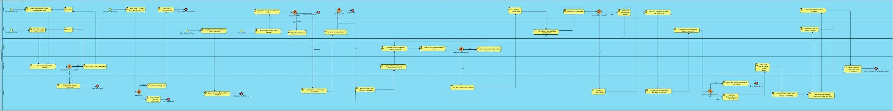

Link PNG BPMN

- Narasi Alur Proses Bisnis Usulan

Alur proses bisnis usulan pada platform SymbioNusa terbagi menjadi 7 fase operasional yang saling terhubung secara runtut:

- Fase A: Pendaftaran Mitra (Onboarding)

- Start Event: Calon mitra (Seller atau Buyer) memulai pendaftaran pada platform.

- Seller/Buyer menginput profil perusahaan (NIB, alamat, koordinat, kontak), mengunggah dokumen legalitas usaha dan dokumen lingkungan yang relevan, serta menyetujui Syarat & Ketentuan (S&K) kepatuhan non-B3.

- Admin meninjau kelengkapan profil dan keabsahan dokumen legalitas.

- Jika dokumen tidak lengkap/valid, Admin menolak pendaftaran disertai alasan untuk direvisi. Jika valid, Sistem memperbarui status perusahaan menjadi Terverifikasi sehingga akun diizinkan melakukan transaksi B2B.

- Fase B: Penawaran & Permintaan Material

- Seller membuat listing sisa produksi dengan memilih kategori non-B3, mengisi spesifikasi teknis sesuai templat, serta mengunggah bukti material (surat pernyataan non-B3, foto sampel, dan sertifikat uji laboratorium jika diwajibkan).

- Sistem mengevaluasi kategori material: jika terdeteksi B3, listing ditolak otomatis. Jika non-B3, listing dipublikasikan dan Seller dapat mengatur jadwal pasokan berkala (Supply Schedule).

- Di sisi kebutuhan, Buyer memublikasikan kriteria bahan baku sekunder (Demand Request).

- Sistem secara otomatis mencocokkan listing dan kebutuhan baru terhadap kriteria daftar pantau (Watchlist) pengguna, lalu mengirimkan notifikasi in-app.

- Fase C: Negosiasi RFQ & Penerbitan Purchase Order (PO)

- Buyer mengajukan Request for Quotation (RFQ) atas listing aktif dengan menentukan volume, harga usulan, dan tenggat waktu negosiasi.

- Seller meninjau RFQ untuk menerima, menolak, atau mengajukan penawaran balik (counter-offer). Siklus penawaran berlangsung hingga disepakati, ditolak, atau kedaluwarsa.

- Setelah kesepakatan tercapai, Sistem mengunci volume dan harga pada kontrak RFQ.

- Buyer menerbitkan Purchase Order (PO) resmi yang secara otomatis menyalin (snapshot) parameter toleransi tonase dan batas kadar air dari kategori material.

- Seller mengonfirmasi PO, lalu Sistem mereservasi stok listing dengan penguncian baris (database row locking) dan mengubah status order menjadi Dikonfirmasi.

- Fase D: Verifikasi Legalitas & Mutu (Inspeksi)

- Admin menugaskan Inspector aktif yang bidang keahliannya sesuai serta menetapkan mode verifikasi (Desk untuk risiko rendah/volume kecil atau Lapangan untuk kasus lainnya) berdasarkan rekomendasi sistem.

- Inspector memverifikasi kelengkapan dokumen legalitas non-B3 menggunakan checklist standar.

- Inspector melakukan verifikasi mutu: pada mode Desk, menilai kesesuaian bukti foto/laboratorium terhadap templat spesifikasi; pada mode Lapangan, mengisi hasil pemeriksaan fisik aktual.

- Jika verifikasi gagal, Seller diminta merevisi bukti atau dilakukan inspeksi ulang. Jika lulus, Sistem memperbarui status order menjadi Lolos Inspeksi.

- Fase E: Invoice & Pembayaran

- Seller menerbitkan invoice resmi atas PO yang telah berstatus Lolos Inspeksi.

- Buyer melakukan transfer bank sesuai nominal invoice dan mengunggah bukti transfer pembayaran.

- Seller memverifikasi kesesuaian bukti bayar. Jika sesuai, Sistem mengubah status order menjadi Dibayar.

- Fase F: Pengiriman & Penerimaan Barang (Fulfillment)

- Seller mencatat data logistik pengiriman (armada, nomor pelat, nama sopir, rute, dan berat awal dikirim).

- Sistem memvalidasi syarat pengiriman (order telah dibayar, verifikasi dokumen non-B3 disetujui, dan berat dikirim tidak melebihi batas atas toleransi), lalu menerbitkan Manifes Angkut PDF otomatis. Status order diperbarui menjadi Dalam Pengiriman.

- Buyer mengonfirmasi penerimaan barang di lokasi dengan mencatat berat aktual diterima, berat ditolak, kadar air terukur, dan kondisi fisik material.

- Sistem mengevaluasi data penerimaan terhadap ambang toleransi PO:

- Dalam Toleransi: Order berstatus Selesai. Sistem menghitung nota penyesuaian harga (adjustment note) atas selisih berat aktual terhadap nominal invoice.

- Di Luar Toleransi: Sistem secara otomatis membuka tiket sengketa dan memperbarui status order menjadi Sengketa.

- Fase G: Penanganan Sengketa, Dampak, & Pengawasan

- Jika order berstatus Sengketa, Admin meninjau bukti kedua belah pihak dan menetapkan putusan penyelesaian (penyesuaian harga, penggantian barang, atau pembatalan transaksi). Sistem menerapkan putusan dan memperbarui status order menjadi Selesai atau Dibatalkan.

- Untuk setiap order yang berstatus Selesai, Sistem memicu ImpactCalculator untuk menghitung akumulasi dampak lingkungan (tonase limbah terolah, penghematan biaya Seller/Buyer, dan emisi `CO2e` yang berhasil ditekan) menggunakan versi faktor emisi aktif, lalu menyimpannya pada tabel impact_logs.

- Seller dan Buyer saling memberikan ulasan dan rating performa transaksi.

- Admin dan Dinas Lingkungan Hidup (DLH) memantau Dasbor Analitik Dampak serta mencatat temuan/peringatan kepatuhan perusahaan pada modul pengawasan.

### Analisis Perubahan dari Proses Bisnis Eksisting ke Proses Usulan

- Aktivitas yang dibuat dalam sistem informasi

| Aktivitas | Dalam Sistem? | Analisis |
|---|---|---|
| Pendaftaran dan verifikasi mitra | Ya (PBI-08) | Menggantikan kepercayaan berbasis kenalan dengan identitas perusahaan terverifikasi |
| Listing material dan jadwal pasokan | Ya (PBI-09, PBI-10) | Mengubah informasi lisan menjadi data spesifikasi, volume, dan jadwal yang dapat dicari |
| Publikasi kebutuhan dan daftar pantau | Ya (PBI-14, PBI-16) | Memperkecil asimetri informasi dua arah |
| Negosiasi harga | Ya (PBI-04) | Jejak penawaran tersimpan dan dapat dipertanggungjawabkan |
| Kontrak/PO | Ya (PBI-05) | Komitmen tertulis dengan status yang terkendali |
| Verifikasi dokumen dan verifikasi mutu | Ya, pencatatan hasil (PBI-17 s.d. PBI-19) | Penilaian berbasis bukti digital dilakukan Inspector di dalam sistem; pemeriksaan lapangan atau uji laboratorium (bila ditetapkan) tetap di luar platform dan hanya hasilnya yang dicatat serta ditegakkan sebagai syarat lanjut |
| Invoice dan verifikasi pembayaran | Ya (PBI-06, PBI-07) | Pembayaran tetap lewat bank; sistem hanya mencatat dan memverifikasi bukti |
| Pengiriman dan manifes | Ya, pencatatan (PBI-11) | Pengiriman fisik tetap dilakukan para pihak |
| Penerimaan dan sengketa | Ya (PBI-12, PBI-13) | Volume aktual menjadi sumber data dampak; sengketa terdokumentasi |
| Ulasan dan pengawasan DLH | Ya (PBI-15, PBI-20) | Membangun reputasi dan akuntabilitas |
| Hitung dampak | Ya (otomatis) | Menggantikan perhitungan manual yang hampir tidak pernah dilakukan |
| Pengangkutan fisik, transfer uang, pengujian laboratorium, dan pemeriksaan lapangan | Tidak | Berada di luar cakupan pure software; dilakukan para pihak, lembaga uji, atau Inspector di luar sistem |

- Efisiensi yang diperoleh

| Aspek | Eksisting | Usulan | Perubahan |
|---|---|---|---|
| Pencarian mitra | Manual, jaringan personal | Katalog, papan kebutuhan, notifikasi otomatis | Waktu pencarian lebih singkat dan jangkauan lebih luas |
| Kepastian mutu dan legalitas | Tidak ada | Verifikasi dokumen dan verifikasi mutu wajib | Risiko B3 dan kontaminasi ditekan |
| Negosiasi | Lisan, tanpa jejak | Terstruktur dan tercatat | Sengketa lebih mudah diselesaikan |
| Biaya pembuangan | Ditanggung penuh Seller | Berkurang, menjadi pendapatan | Seller memperoleh nilai ekonomi |
| Biaya bahan baku | Bahan primer | Bahan sekunder lebih murah | Buyer menghemat selisih harga |
| Pencatatan | Tidak ada | Seluruh siklus tercatat | Data dasar untuk pengawasan |
| Selisih tonase dan kadar air | Tidak diatur, sengketa informal | Toleransi per kategori, evaluasi otomatis saat penerimaan, nota penyesuaian | Sengketa hanya muncul pada selisih di luar toleransi |
| Dampak lingkungan | Tidak diukur | Dihitung otomatis per transaksi | Bukti kontribusi terhadap SDG 12 |

Kesimpulannya, SymbioNusa tidak menggantikan aktivitas fisik, tetapi mendigitalkan seluruh koordinasi, verifikasi, dan pencatatan yang pada proses existing menjadi sumber biaya, risiko, dan hilangnya nilai material.

# Kebutuhan Sistem

## Kebutuhan Fungsional

### Daftar Kebutuhan

Kebutuhan fungsional disusun sebagai 20 Product Backlog Item (PBI) fungsional bisnis yang dibagi kepada enam anggota tim. Seluruh anggota adalah Fullstack Developer, sehingga setiap PBI dikerjakan end-to-end oleh penanggung jawabnya (antarmuka, logika API, dan kueri basis data). Ketentuan penyusunan:

- Setiap anggota memegang minimal 3 PBI.

- Setiap PBI memiliki satu tujuan bisnis yang jelas; fungsi yang memiliki tujuan berbeda dipisah menjadi PBI tersendiri (misalnya penerbitan invoice dan verifikasi pembayaran, atau penugasan inspeksi dan pengisian hasil verifikasi mutu).

- Kerumitan PBI berskala menengah: setiap PBI membuat operasi CRUD pada satu entitas utama dan aturan bisnis yang tidak sepele (validasi lintas data, status, atau batas waktu), tetapi dibatasi pada satu tahap proses sehingga tidak menjadi terlalu luas.

- Login, logout, reset password, dan Main Dashboard dasar tidak dihitung sebagai PBI individu (lihat tabel fondasi kolektif di bawah).

- Tabel Kebutuhan Fungsional

| ID | Kebutuhan Fungsional | Deskripsi Fungsional & Tujuan Bisnis | Penanggung Jawab |
|---|---|---|---|
| PBI-01 | Registri Inspector & Sertifikasi Kompetensi | Aktor: Admin; Inspector (melihat profil sendiri). Deskripsi: Admin mendaftarkan Inspector beserta bidang keahlian (kategori material), wilayah tugas, nomor dan berkas sertifikasi, serta masa berlaku. Status Inspector otomatis menjadi nonaktif ketika sertifikasi kedaluwarsa dan hanya Inspector aktif yang dapat dipilih pada penugasan. Admin dapat mencari dan menyaring registri berdasarkan keahlian, wilayah, dan status. Tujuan bisnis: memastikan hanya Inspector yang berkompeten dan berwenang yang dapat menilai material. | Mayhesa Rachmadiharja (Fullstack, Master Data & Impact Module) |
| PBI-02 | Master Kategori Material, Templat Spesifikasi & Toleransi | Aktor: Admin. Deskripsi: Admin membuat kategori material hierarkis (induk dan subkategori), mendefinisikan templat parameter spesifikasi (misalnya kadar air, ukuran, tingkat kebersihan) beserta parameter wajibnya, serta menandai kategori yang dilarang karena tergolong B3. Setiap kategori juga memuat toleransi selisih tonase (%), batas kadar air maksimum beserta toleransinya (bila relevan), tingkat risiko (rendah atau tinggi), dan penanda wajib tidaknya sertifikat uji laboratorium. Kategori yang masih dipakai listing aktif tidak dapat diarsipkan, dan perubahan toleransi tidak memengaruhi PO yang sudah berjalan. Tujuan bisnis: menyeragamkan klasifikasi dan standar spesifikasi material agar penawaran dapat dibandingkan, bebas B3, dan memiliki batas toleransi yang jelas. | Mayhesa Rachmadiharja (Fullstack, Master Data & Impact Module) |
| PBI-03 | Parameter Dampak & Faktor Emisi | Aktor: Admin. Deskripsi: Admin mengelola faktor emisi (pembuangan awal, bahan primer, pemrosesan, angkutan), substitution rate, serta harga referensi bahan primer dan biaya buang per kategori. Setiap perubahan membuat versi baru dengan tanggal berlaku; hanya satu versi aktif per kategori, dan hasil perhitungan lama tetap memakai versi saat transaksi selesai. Tersedia simulasi pratinjau dampak untuk contoh volume. Tujuan bisnis: menjaga dasar perhitungan dampak tetap valid, dapat dilacak, dan dapat diperbarui. | Mayhesa Rachmadiharja (Fullstack, Master Data & Impact Module) |
| PBI-04 | RFQ & Negosiasi Penawaran | Aktor: Buyer; Seller. Deskripsi: Buyer mengajukan RFQ atas listing (volume, harga yang diajukan, tenggat); Seller menerima, menolak, atau mengajukan penawaran balik. Penawaran bergantian dalam utas dengan batas jumlah putaran, volume tidak boleh melebihi stok listing, RFQ atas listing milik perusahaan sendiri ditolak, dan RFQ yang melewati tenggat berstatus kedaluwarsa otomatis. Penawaran yang disepakati mengunci harga dan volume pada kontrak RFQ. Buyer dapat menarik RFQ yang belum ditanggapi. Tujuan bisnis: mencapai kesepakatan harga dan volume yang transparan dan tercatat. | Achmad Dhafi Fadilah (Fullstack, Transaction Module) |
| PBI-05 | Purchase Order (PO) | Aktor: Buyer; Seller. Deskripsi: PO dibuat dari kontrak RFQ yang sudah disepakati dan mencatat volume nominal, harga, serta salinan (snapshot) toleransi tonase dan batas kadar air dari kategori pada saat itu. Seller mengonfirmasi atau menolak PO dalam batas waktu; saat dikonfirmasi, stok listing direservasi dengan penguncian baris (lock) agar tidak terjadi pemesanan berlebih oleh dua PO bersamaan. PO hanya dapat dibatalkan sebelum inspeksi dimulai, dan draf PO dapat dihapus. Cakupan PBI ini dibatasi pada status Draf, Menunggu Konfirmasi, Dikonfirmasi, Ditolak, dan Dibatalkan; tahap selanjutnya ditangani PBI lain. Tujuan bisnis: mengikat komitmen pembelian kedua pihak beserta batas toleransi yang disepakati. | Achmad Dhafi Fadilah (Fullstack, Transaction Module) |
| PBI-06 | Penerbitan Invoice | Aktor: Seller; Buyer (melihat dan mengunduh). Deskripsi: Seller menerbitkan invoice atas PO yang telah lolos inspeksi. Nomor invoice dibuat otomatis, total dihitung dari volume nominal dan harga PO, dan jatuh tempo ditetapkan. Invoice dapat diunduh sebagai PDF, tersedia rekap umur tagihan, dan invoice yang belum dibayar dapat dibatalkan (void) tanpa dihapus demi jejak audit. Selisih akibat toleransi tonase tidak mengubah invoice, melainkan dicatat sebagai nota penyesuaian pada penerimaan (PBI-12). Tujuan bisnis: menagih pembayaran atas transaksi yang telah lolos pemeriksaan. | Achmad Dhafi Fadilah (Fullstack, Transaction Module) |
| PBI-07 | Verifikasi Pembayaran | Aktor: Buyer; Seller. Deskripsi: Buyer mengunggah bukti transfer (tanggal, nominal, rekening asal); Seller memverifikasi atau menolak dengan alasan. Nominal harus sama dengan invoice, bukti hanya dapat diganti sebelum diverifikasi, bukti yang tidak diunggah sampai batas waktu setelah invoice diberi peringatan, dan verifikasi yang valid mengubah status order menjadi Dibayar. Tujuan bisnis: memastikan dana telah diterima sebelum material dikirim. | M Zacky Aghaatsa (Fullstack, Buyer Demand, Payment & Engagement Module) |
| PBI-08 | Profil & Verifikasi Legalitas Perusahaan | Aktor: Seller; Buyer; Admin. Deskripsi: Perusahaan mendaftar dan mengelola profil (NIB, alamat, koordinat, kontak, serta tipe mitra: Seller, Buyer, atau keduanya) dan mengunggah dokumen wajib sesuai tipe mitra, yaitu dokumen legalitas usaha, dokumen lingkungan yang relevan sesuai skala usaha, dan untuk Buyer dokumen yang menunjukkan kegiatan pemanfaatan, masing-masing dengan masa berlaku. Pendaftaran mensyaratkan persetujuan syarat dan ketentuan (versi dan waktu persetujuan dicatat). Admin meninjau dan menyetujui atau menolak dengan alasan. Hanya perusahaan berstatus Terverifikasi yang dapat memublikasikan listing, kebutuhan, atau bertransaksi; dokumen kedaluwarsa dapat dihapus dan diganti, dan status kembali ke Tinjauan Ulang bila dokumen wajib kedaluwarsa. Tujuan bisnis: memastikan hanya mitra terverifikasi yang bertransaksi. | Haris Permana (Fullstack, Seller Catalog Module) |
| PBI-09 | Listing Sisa Produksi | Aktor: Seller; Admin (moderasi); Buyer (melihat katalog). Deskripsi: Seller membuat listing (kategori, spesifikasi mengikuti templat kategori, volume, harga per kg, lokasi, metode pembuangan sebelumnya, biaya buang) dari draf hingga publikasi, dan melampirkan bukti material: surat pernyataan non-B3, foto sampel beserta tanggal pengambilan, dan sertifikat uji laboratorium bila diwajibkan kategori. Lampiran dapat diperbarui sebelum inspeksi dan menjadi bahan verifikasi Inspector. Kategori B3 ditolak, stok berkurang oleh reservasi PO, dan listing dapat diarsipkan. Katalog menyediakan pencarian dan penyaringan. Tujuan bisnis: menawarkan sisa produksi ke pasar secara terspesifikasi dan berbukti. | Haris Permana (Fullstack, Seller Catalog Module) |
| PBI-10 | Jadwal Pasokan Berkala | Aktor: Seller; Buyer (melihat). Deskripsi: Seller menetapkan jadwal pasokan berulang (mingguan atau bulanan) per listing dengan volume per periode. Volume periode tidak boleh melebihi kapasitas yang diumumkan, perubahan tidak mempengaruhi periode yang sudah dipesan, dan jadwal dapat dihentikan. Tersedia tampilan kalender dan proyeksi volume. Tujuan bisnis: memberi kepastian pasokan terjadwal bagi Buyer. | Haris Permana (Fullstack, Seller Catalog Module) |
| PBI-11 | Pengiriman & Manifes Angkut | Aktor: Seller; Buyer, Inspector, Admin (melihat). Deskripsi: Seller mencatat pengiriman (armada, plat, sopir, jadwal, rute, berat dikirim) dan dapat melampirkan surat jalan internal. Pengiriman hanya dapat dimulai untuk order yang sudah dibayar dan verifikasi dokumen non-B3-nya disetujui, dengan berat dikirim tidak melebihi batas atas toleransi PO. Sistem menerbitkan manifes angkut otomatis (PDF) berisi identitas para pihak, material, berat, kendaraan, dan rujukan verifikasi; draf pengiriman dapat dibatalkan. Status pengiriman diperbarui sampai tiba. Tujuan bisnis: mendokumentasikan perpindahan material secara tertib dan dapat ditelusuri. | Inaya Keisha Sukmawardy (Fullstack, Logistics & Fulfillment Module) |
| PBI-12 | Penerimaan Barang & Realisasi Tonase | Aktor: Buyer; Seller, Admin (melihat). Deskripsi: Buyer mencatat berat diterima, berat ditolak, kadar air (bila disyaratkan kategori), dan kondisi material. Jumlah diterima ditambah ditolak tidak boleh melampaui berat dikirim ditambah toleransi penimbangan; koreksi hanya dalam batas waktu. Sistem mengevaluasi hasil terhadap toleransi PO: bila dalam toleransi, order Selesai dan selisih nilai dicatat sebagai nota penyesuaian; bila di luar toleransi, tiket sengketa dibuka otomatis. Berat diterima yang disetujui menjadi sumber data dampak. Tujuan bisnis: menetapkan volume aktual sebagai dasar penutupan transaksi dan perhitungan dampak. | Inaya Keisha Sukmawardy (Fullstack, Logistics & Fulfillment Module) |
| PBI-13 | Sengketa & Klaim Ketidaksesuaian | Aktor: Buyer; Seller; Admin. Deskripsi: Pihak yang dirugikan membuat tiket sengketa (jenis, deskripsi, bukti) dalam batas waktu setelah penerimaan; tiket jenis selisih tonase atau kadar air di luar toleransi dibuka otomatis oleh sistem. Pihak lawan menanggapi, Admin memutus penyelesaian (penyesuaian, penggantian, atau pembatalan), dan pelapor dapat menarik tiket sebelum ditanggapi. Tujuan bisnis: menyelesaikan ketidaksesuaian antarmitra secara adil dan terdokumentasi. | Inaya Keisha Sukmawardy (Fullstack, Logistics & Fulfillment Module) |
| PBI-14 | Kebutuhan Bahan Baku Sekunder | Aktor: Buyer; Seller (melihat). Deskripsi: Buyer memublikasikan kebutuhan (kategori, spesifikasi minimal mengikuti templat, volume, frekuensi, harga maksimal, masa berlaku). Kebutuhan otomatis tertutup saat masa berlaku habis atau terpenuhi, dan draf dapat dihapus. Seller melihat papan kebutuhan beserta penyaringannya. Tujuan bisnis: menyampaikan permintaan pasar kepada Seller agar penawaran lebih terarah. | M Zacky Aghaatsa (Fullstack, Buyer Demand, Payment & Engagement Module) |
| PBI-15 | Ulasan & Rating Mitra | Aktor: Buyer; Seller; Admin (moderasi). Deskripsi: Setelah order Selesai, kedua pihak dapat memberi satu ulasan per order (mutu, ketepatan, komunikasi) dan menyuntingnya dalam 7 hari. Sistem menghitung skor rata-rata mitra dan menampilkannya pada profil dan katalog. Admin dapat menghapus ulasan yang melanggar ketentuan. Tujuan bisnis: membangun reputasi dan kepercayaan antarmitra. | M Zacky Aghaatsa (Fullstack, Buyer Demand, Payment & Engagement Module) |
| PBI-16 | Daftar Pantau & Peringatan Material | Aktor: Buyer; Seller. Deskripsi: Pengguna membuat pantauan berdasarkan kriteria (kategori, wilayah, rentang volume, rentang harga) dan menerima notifikasi otomatis ketika listing atau kebutuhan baru yang cocok dipublikasikan. Kriteria dapat diubah dan pantauan dapat dihapus. Tujuan bisnis: memberi tahu pengguna peluang transaksi yang relevan tanpa pencarian manual. | M Zacky Aghaatsa (Fullstack, Buyer Demand, Payment & Engagement Module) |
| PBI-17 | Verifikasi Dokumen Legalitas Non-B3 | Aktor: Inspector; Seller (melihat hasil). Deskripsi: Inspector memeriksa dokumen per order memakai checklist per jenis dokumen: surat pernyataan non-B3 Seller, dokumen legalitas dan dokumen lingkungan para pihak (dari PBI-08), serta bukti pada listing (dari PBI-09), lalu menyetujui atau menolak dengan alasan. Hasil verifikasi menjadi syarat sebelum order dapat dikirim; verifikasi yang keliru dapat dibatalkan. Tujuan bisnis: memastikan legalitas non-B3 material sebelum dikirim. | Rosita Jian Syahiirah (Fullstack, Inspection & Compliance Module) |
| PBI-18 | Penugasan Inspeksi | Aktor: Admin; Inspector (menerima). Deskripsi: Admin menugaskan Inspector untuk order yang telah dikonfirmasi. Pilihan hanya memunculkan Inspector aktif yang bidang keahliannya sesuai (berdasarkan PBI-01). Sistem merekomendasikan mode verifikasi berdasarkan tingkat risiko kategori, volume, dan riwayat Seller: Desk (tinjauan bukti digital, tanpa kunjungan) untuk kasus berisiko rendah, atau Lapangan (pemeriksaan di luar platform, dengan penyaringan wilayah tugas) untuk kasus lain; Admin dapat menimpa rekomendasi dengan alasan tercatat. Penugasan menetapkan jadwal, mencegah bentrok jadwal, dan dapat ditugaskan ulang atau dibatalkan. Tujuan bisnis: menugaskan pemeriksa dan tingkat verifikasi yang tepat pada setiap transaksi. | Rosita Jian Syahiirah (Fullstack, Inspection & Compliance Module) |
| PBI-19 | Laporan Hasil Verifikasi Mutu | Aktor: Inspector; Seller, Buyer, Admin (melihat). Deskripsi: Inspector mengisi hasil verifikasi mutu berdasarkan parameter templat kategori (nilai parameter, sumber bukti, dan lampiran). Pada mode Desk, penilaian bertumpu pada foto sampel, sertifikat laboratorium, dan data parameter dari Seller; pada mode Lapangan, Inspector mencatat hasil pemeriksaan yang dilakukan di luar platform. Sistem menetapkan lulus atau gagal berdasarkan ambang parameter, laporan dapat direvisi sebelum difinalisasi, dan laporan final mengubah status order menjadi Lolos atau Gagal Inspeksi. Tujuan bisnis: memastikan mutu material sesuai spesifikasi yang dijanjikan. | Rosita Jian Syahiirah (Fullstack, Inspection & Compliance Module) |
| PBI-20 | Pengawasan & Tindak Lanjut DLH | Aktor: Admin/DLH; Seller dan Buyer (melihat catatan perusahaan sendiri). Deskripsi: DLH mencatat temuan atau peringatan terhadap perusahaan (jenis, deskripsi, tenggat), memperbarui status tindak lanjut (Temuan, Peringatan, Ditindaklanjuti, Selesai), menyaring daftar per perusahaan atau status, serta mengekspor daftar temuan. Catatan yang keliru dapat dihapus oleh pembuatnya. Tujuan bisnis: menjaga kepatuhan perusahaan terhadap ketentuan lingkungan. | Rosita Jian Syahiirah (Fullstack, Inspection & Compliance Module) |

Rekapitulasi beban PBI: Mayhesa 3 PBI (PBI-01, 02, 03), Dhafi 3 PBI (PBI-04, 05, 06), Haris 3 PBI (PBI-08, 09, 10), Inaya 3 PBI (PBI-11, 12, 13), Zacky 4 PBI (PBI-07, 14, 15, 16), dan Rosita 4 PBI (PBI-17, 18, 19, 20). Total 20 PBI; seluruh anggota memenuhi ketentuan minimal 3 PBI.

Keseimbangan beban. Agar pembagian adil, beban dinilai tidak hanya dari jumlah PBI tetapi juga dari bobot kompleksitas (story point, skala Fibonacci; estimasi awal tim).

| Anggota | PBI dan Bobot (SP) | Total SP |
|---|---|---|
| Mayhesa | PBI-01 (3), PBI-02 (5), PBI-03 (5) | 13* |
| Dhafi | PBI-04 (8), PBI-05 (5), PBI-06 (5) | 18 |
| Haris | PBI-08 (5), PBI-09 (8), PBI-10 (5) | 18 |
| Inaya | PBI-11 (5), PBI-12 (8), PBI-13 (5) | 18 |
| Zacky | PBI-07 (3), PBI-14 (5), PBI-15 (3), PBI-16 (5) | 16 |
| Rosita | PBI-17 (5), PBI-18 (5), PBI-19 (5), PBI-20 (3) | 18 |

*Mayhesa juga bertindak sebagai Project Manager dan memimpin ImpactCalculator (setara beban tambahan ± 5 SP), sehingga beban efektifnya ± 18 SP. Total seluruh PBI adalah 101 SP (rata-rata ± 17 SP per anggota).

- Variasi Operasi CRUD per PBI

Setiap PBI memuat empat operasi pada entitas utamanya, kecuali bila operasi hapus fisik tidak sesuai dengan kebutuhan audit (ditandai "–"). Kolom Operasi Dominan menunjukkan operasi yang paling ditonjolkan pada demonstrasi.

| ID | Entitas Utama | C (Create) | R (Read) | U (Update) | D (Delete) | Operasi Dominan |
|---|---|---|---|---|---|---|
| PBI-01 | inspector_profiles | Daftarkan Inspector | Daftar dan filter | Perpanjang sertifikasi, ubah wilayah | Keluarkan dari registri (soft delete) | Update |
| PBI-02 | categories | Buat kategori dan templat | Pohon kategori | Ubah templat dan penanda B3 | Arsipkan bila tidak dipakai | Create |
| PBI-03 | impact_factors | Buat versi faktor baru | Riwayat versi dan simulasi | Koreksi sebelum berlaku | – (versi lama dinonaktifkan) | Read |
| PBI-04 | rfq_contracts, rfq_offers | Buat RFQ dan penawaran | Utas negosiasi | Setuju, tolak, ubah penawaran | Tarik RFQ belum ditanggapi | Create |
| PBI-05 | purchase_orders | Buat PO dari kontrak | Detail dan riwayat status | Konfirmasi, tolak, batalkan | Hapus draf PO | Update |
| PBI-06 | invoices | Terbitkan invoice | Rekap umur tagihan, unduh PDF | Void invoice | – (tidak dihapus demi audit) | Create |
| PBI-07 | payments | Unggah bukti transfer | Daftar bukti | Verifikasi atau tolak | Hapus bukti salah sebelum diverifikasi | Update |
| PBI-08 | companies, company_documents | Daftar profil, unggah dokumen | Lihat profil | Revisi, setujui atau tolak | Hapus dokumen kedaluwarsa | Update |
| PBI-09 | listings, listing_attachments | Buat listing (draf) dan unggah bukti | Katalog dan pencarian | Ubah stok, harga, status, bukti | Arsipkan listing | Create |
| PBI-10 | supply_schedules | Buat jadwal | Kalender dan proyeksi | Ubah volume periode | Hentikan jadwal | Read |
| PBI-11 | shipments_manifests, shipment_documents | Buat pengiriman, unggah dokumen | Pelacakan status | Perbarui status dan jadwal | Batalkan pengiriman draf | Create |
| PBI-12 | goods_receipts | Catat penerimaan dan evaluasi toleransi | Riwayat penerimaan dan nota penyesuaian | Koreksi berat dalam batas waktu | – (koreksi dilakukan lewat Update) | Update |
| PBI-13 | disputes | Buat tiket sengketa | Daftar dan status tiket | Tanggapan dan putusan | Tarik tiket sebelum ditanggapi | Delete |
| PBI-14 | demand_requests | Publikasi kebutuhan | Papan kebutuhan | Ubah atau tutup | Hapus draf | Create |
| PBI-15 | reviews | Tulis ulasan | Skor rata-rata dan riwayat | Sunting dalam 7 hari | Hapus oleh moderator | Read |
| PBI-16 | watchlists | Tambah pantauan | Daftar pantauan | Ubah kriteria | Hapus pantauan | Delete |
| PBI-17 | document_verifications | Buat catatan verifikasi | Antrean verifikasi | Setujui atau tolak | Batalkan verifikasi keliru | Update |
| PBI-18 | inspections | Buat penugasan dan tetapkan mode verifikasi | Daftar tugas dan jadwal | Ubah jadwal, tugaskan ulang | Batalkan penugasan | Create |
| PBI-19 | inspection_results | Isi laporan hasil verifikasi mutu | Lihat laporan | Revisi sebelum final | – (laporan final tidak dihapus) | Create |
| PBI-20 | compliance_notes | Catat temuan | Daftar per perusahaan dan ekspor | Perbarui status tindak lanjut | Hapus catatan keliru | Read |

Sebaran operasi dominan: Create (PBI-02, 04, 06, 09, 11, 14, 18, 19), Read (PBI-03, 10, 15, 20), Update (PBI-01, 05, 07, 08, 12, 17), dan Delete (PBI-13, 16). Setiap anggota memegang PBI dengan sedikitnya dua operasi dominan yang berbeda.

- Aturan Bisnis Toleransi Tonase dan Kadar Air

Sisa produksi, terutama yang berkadar air tinggi (ampas tahu, ampas kopi, roti sisa), dapat berubah berat selama penyimpanan dan pengangkutan (penguapan, penyerapan air, kehilangan di perjalanan), dan penimbangan di dua lokasi yang berbeda hampir selalu menghasilkan selisih. Tanpa aturan toleransi, hampir setiap order berpotensi menjadi sengketa. Aturan berikut diterapkan pada PBI-02, 05, 11, 12, dan 13.

| Simbol | Arti | Sumber |
|---|---|---|
| V | Volume nominal PO (kg) | PBI-05 |
| t | Toleransi selisih tonase (%), disalin dari kategori ke PO | PBI-02, PBI-05 |
| `Bmin` , `Bmax` |  | Dihitung sistem |
| `Wkirim` | Berat dikirim menurut catatan pengiriman (kg) | PBI-11 |
| `Qacc` , `Qrej` | Berat diterima yang disetujui dan berat ditolak (kg) | PBI-12 |
| `KAmax` , `ΔKA` | Batas kadar air maksimum (%) dan toleransinya (poin persentase) | PBI-02, PBI-05 |
| `KAterima` | Kadar air terukur saat penerimaan (%), bila disyaratkan kategori | PBI-12 |

Aturan:

- Penetapan (PBI-05): Saat PO dibuat, t, `KAmax` , dan `ΔKA` disalin dari kategori sehingga perubahan master di kemudian hari tidak mengubah PO yang berjalan.

- Batas pengiriman (PBI-11): `Wkirim` tidak boleh melebihi `Bmax` . Pengiriman di bawah `Bmin` diperbolehkan dengan peringatan dan alasan Seller, karena akan dievaluasi saat penerimaan.

- Evaluasi penerimaan (PBI-12): Penerimaan dalam toleransi bila `Bmin` `Qacc` `Bmax` dan, bila kategori mensyaratkan, `KAterima` `KAmax` + `ΔKA` . Selain itu penerimaan di luar toleransi. Jumlah `Qacc` + `Qrej` tidak boleh melebihi `Wkirim` × (1 + t).

- Dalam toleransi: Order menjadi Selesai. Nilai final adalah `Qacc` × harga, dan selisih terhadap invoice, yaitu ( `Qacc`

- Di luar toleransi: Sistem otomatis membuka tiket sengketa (PBI-13) bertipe selisih tonase atau kadar air dan order berstatus Sengketa. Admin memutus penyesuaian harga, pengembalian, atau pembatalan.

- Dampak (mesin dampak): Perhitungan memakai `Qacc` sebagai berat as-received; faktor emisi per kategori pada PBI-03 didefinisikan pada basis berat yang sama.

- Verifikasi mutu (PBI-19): Parameter kadar air pada templat memiliki ambang maksimum; hasil yang melampauinya menyebabkan penilaian Gagal.

Contoh (angka ilustrasi): ampas tahu dengan V = 5.000 kg, t = 5%, dan harga Rp 600/kg memiliki `Bmin` = 4.750 kg dan `Bmax` = 5.250 kg. Jika `Qacc` `Qacc` = 4.600 kg (di bawah `Bmin` ), sistem membuka sengketa.

Nilai awal toleransi per kelompok material (kebijakan awal untuk demonstrasi; dapat diubah Admin pada PBI-02 dan sebaiknya divalidasi dengan pelaku industri):

| Kelompok Material | Contoh | Toleransi Tonase (t) | Pemeriksaan Kadar Air | Tingkat Risiko Awal |
|---|---|---|---|---|
| Kering anorganik | Kain perca, cacahan plastik | 2% | Tidak diperlukan | Rendah |
| Kering organik | Serbuk kayu | 3% | Ya, toleransi 2 poin persentase | Rendah |
| Organik basah | Ampas tahu, ampas kopi, roti sisa | 5% | Ya, toleransi 3 poin persentase | Tinggi |

- Parameter Kebijakan Platform (Nilai Awal)

Parameter berikut disimpan pada berkas konfigurasi Laravel config/symbionusa.php (bukan fitur CRUD) agar mudah disesuaikan tanpa mengubah kode logika.

| Parameter | Nilai Awal | Dipakai pada |
|---|---|---|
| Tenggat RFQ | 3 hari kalender (maksimal 7) | PBI-04 |
| Jumlah putaran negosiasi maksimal | 5 | PBI-04 |
| Batas konfirmasi PO oleh Seller | 2 × 24 jam | PBI-05 |
| Jatuh tempo invoice dan batas unggah bukti bayar | 3 hari kalender | PBI-06, PBI-07 |
| Jendela koreksi penerimaan | 24 jam | PBI-12 |
| Batas pelaporan sengketa sejak penerimaan | 3 hari kalender | PBI-13 |
| Jendela sunting ulasan | 7 hari | PBI-15 |
| Ambang mode Desk |  | PBI-18 |
| Ukuran maksimal berkas unggahan | 5 MB (PDF, JPG, PNG) | Seluruh unggahan |

E. Fitur Fondasi Kolektif (Tidak Dihitung sebagai PBI Individu)

Fitur berikut wajib ada dan dikerjakan bersama oleh seluruh anggota tim sebagai fondasi aplikasi.

| ID | Fondasi | Deskripsi |
|---|---|---|
| FND-01 | Login | Autentikasi dengan email dan kata sandi (Laravel Breeze), pembuatan sesi, dan pengalihan ke halaman sesuai peran. |
| FND-02 | Logout | Mengakhiri sesi aktif dan meregenerasi token CSRF. |
| FND-03 | Reset Password | Permintaan tautan reset melalui email dengan token berbatas waktu dan pengaturan kata sandi baru. |
| FND-04 | Main Dashboard Dasar | Kerangka halaman utama per peran (navigasi, layout, dan kartu ringkasan). Setiap anggota menyumbang satu kartu ringkasan dari modulnya; mesin perhitungan dampak menyuplai kartu dampak. |

### Karakteristik Pengguna

Tabel 1 Karakteristik Pengguna

| Kategori Pengguna | Deskripsi | Hak Akses |
|---|---|---|
| Admin Platform / DLH | Pengelola platform sekaligus pengawas dan pemantau dampak. Terdiri atas Super Admin (konfigurasi platform) dan DLH Officer (pemantauan dan tindak lanjut kepatuhan). | Create, Read, Update, Delete pada kategori material (PBI-02), parameter dampak (PBI-03), registri Inspector (PBI-01), dan catatan pengawasan (PBI-20). Read, Update pada verifikasi perusahaan (PBI-08) dan moderasi listing (PBI-09). Create, Update pada penugasan inspeksi (PBI-18) dan putusan sengketa (PBI-13). Delete ulasan yang melanggar (PBI-15). Read seluruh data transaksi dan Main Dashboard dampak. |
| Perusahaan Penghasil (Seller) | Pabrik atau UMKM berbadan usaha yang menjual sisa produksi non-B3. Data terisolasi per perusahaan. | Create, Read, Update, Delete pada profil dan dokumen (PBI-08), listing (PBI-09), jadwal pasokan (PBI-10), pengiriman (PBI-11), dan daftar pantau (PBI-16). Read, Update pada RFQ (PBI-04) dan PO (PBI-05). Create, Read, Update pada invoice (PBI-06), verifikasi pembayaran (PBI-07), dan ulasan (PBI-15). Create, Read pada sengketa (PBI-13). Read kebutuhan Buyer (PBI-14), hasil inspeksi, dan catatan pengawasan perusahaan sendiri. |
| Perusahaan Pengolah (Buyer) | Industri pembeli bahan baku sekunder. Data terisolasi per perusahaan. | Create, Read, Update, Delete pada profil dan dokumen (PBI-08), kebutuhan bahan baku (PBI-14), dan daftar pantau (PBI-16). Create, Read, Update, Delete pada RFQ (PBI-04) dan PO (PBI-05) yang dimiliki. Create bukti pembayaran (PBI-07). Create, Read, Update pada penerimaan barang (PBI-12) dan ulasan (PBI-15). Create, Read, Delete pada sengketa (PBI-13). Read katalog (PBI-09), jadwal pasokan (PBI-10), invoice (PBI-06), pengiriman (PBI-11), dan hasil inspeksi. |
| Inspector / Verifikator | Tim verifikasi mutu dan legalitas dokumen non-B3; pihak netral yang kompetensinya terdaftar. Bekerja terutama berbasis bukti digital (mode Desk), dengan pemeriksaan lapangan opsional di luar platform (mode Lapangan) yang hasilnya dicatat di sistem. | Create, Read, Update, Delete pada verifikasi dokumen (PBI-17). Create, Read, Update pada laporan hasil verifikasi mutu (PBI-19). Read, Update pada penugasan yang diterima (PBI-18). Read, Update profil kompetensi sendiri (PBI-01). Read data order, bukti pada listing, dan pengiriman yang ditugaskan. |

Perusahaan dapat terdaftar sebagai Seller, Buyer, atau keduanya. Untuk perusahaan bertipe keduanya, pengguna beralih antara tampilan Seller dan Buyer melalui pemilih peran aktif, dan sistem menolak transaksi dengan perusahaan sendiri.

Seluruh pengguna memperoleh fondasi Login, Logout, dan Reset Password (FND-01 s.d. FND-03) serta Main Dashboard sesuai perannya (FND-04).

## Kebutuhan Non Fungsional

| ID | Kebutuhan Non Fungsional | Deskripsi |
|---|---|---|
| NFR-01 | Performance: waktu respons | Sedikitnya 95% permintaan baca (katalog, daftar, detail) selesai dalam 3 detik dan operasi tulis dalam 5 detik pada beban 100 pengguna serentak. Daftar memakai paginasi (maksimal 20 data per halaman) dan kolom penyaringan diberi indeks basis data. |
| NFR-02 | Performance: pengolahan berkas | Unggah berkas (PDF, JPG, PNG) maksimal 5 MB per berkas dengan indikator kemajuan; pembuatan PDF invoice selesai dalam 5 detik. |
| NFR-03 | Security: autentikasi | Kata sandi disimpan dengan hash bawaan Laravel (bcrypt atau Argon2), minimal 8 karakter, sesi berbasis cookie dengan proteksi CSRF dan masa berlaku terbatas, serta pembatasan percobaan masuk (throttle). |
| NFR-04 | Security: otorisasi | Role-Based Access Control ditegakkan di sisi server pada setiap endpoint; data Seller dan Buyer diisolasi per company_id sehingga satu perusahaan tidak dapat mengakses data perusahaan lain (Sandhu dkk., 1996). |
| NFR-05 | Security: perlindungan aplikasi | Validasi seluruh masukan melalui Form Request, escaping otomatis Blade, kueri berparameter Eloquent, proteksi terhadap kerentanan pada daftar OWASP Top 10 (misalnya injeksi, broken access control, dan XSS), validasi tipe dan ukuran berkas, serta security headers melalui middleware (OWASP, 2021). |
| NFR-06 | Security: transport dan rahasia | Seluruh lalu lintas melalui HTTPS; kredensial dan kunci disimpan pada variabel lingkungan dan tidak masuk repositori. |
| NFR-07 | Availability | Ketersediaan sedikitnya 99% selama masa demonstrasi dan penilaian; pencadangan basis data otomatis harian dengan target RPO 24 jam dan RTO 4 jam. |
| NFR-08 | Reliability: integritas data | Operasi lintas tabel memakai transaksi basis data (atomik); foreign key dan constraint menjaga konsistensi; state machine order menolak transisi yang tidak sah. |
| NFR-09 | Auditability | Setiap perubahan status order dan aksi sensitif (verifikasi, putusan sengketa, perubahan parameter dampak) dicatat pada order_status_history dan audit_logs beserta pelaku dan waktu; catatan tidak dapat diubah oleh pengguna biasa. |
| NFR-10 | Usability | Antarmuka berbahasa Indonesia, konsisten, responsif (lebar layar minimal 360 px), aksi utama dapat dicapai dalam maksimal tiga klik dari dasbor, pesan galat jelas dan spesifik, serta formulir menampilkan validasi langsung. |
| NFR-11 | Compatibility | Berjalan pada dua versi terbaru Chrome, Edge, Firefox, dan Safari. Mata uang Rupiah, satuan kg/ton, dan zona waktu WIB. |
| NFR-12 | Scalability | Sesi dan antrean disimpan pada basis data atau Redis sehingga server aplikasi dapat direplikasi, berkas disimpan pada penyimpanan terpisah (disk kompatibel S3), dan kueri berat (agregasi dampak) memakai tabel ringkasan impact_logs. |
| NFR-13 | Maintainability | Kode modular per domain mengikuti standar PSR-12 (ditegakkan Laravel Pint) dengan analisis statis Larastan, dokumentasi endpoint dengan Scribe, cakupan uji otomatis minimal 60% pada logika bisnis inti, dan code review sebelum penggabungan. |
| NFR-14 | Compliance: regulasi lingkungan dan posisi platform | Platform hanya memperbolehkan kategori non-B3; kategori B3 diblokir dan verifikasi dokumen legalitas menjadi syarat pengiriman, selaras dengan UU No. 32 Tahun 2009 dan PP No. 22 Tahun 2021. Platform memosisikan diri sebagai perantara sistem elektronik: persetujuan syarat dan ketentuan yang memuat tanggung jawab kepatuhan Seller dan Buyer dicatat (versi dan waktu), dan hasil verifikasi tidak menggantikan penetapan instansi berwenang. |
| NFR-15 | Compliance: data pribadi dan elektronik | Pengelolaan data kontak pengguna mengikuti prinsip minimisasi dan pelindungan data pribadi (UU No. 27 Tahun 2022) serta ketentuan penyelenggaraan sistem elektronik (UU ITE dan PP No. 71 Tahun 2019); data hanya dipakai untuk fungsi platform. |
| NFR-16 | Akurasi perhitungan dampak | Hasil perhitungan dampak bersifat deterministik, menyimpan versi parameter yang dipakai, dan dibulatkan secara konsisten (tonase dua desimal, Rupiah bilangan bulat, emisi dua desimal). |
| NFR-17 | Konsistensi aturan bisnis | Parameter kebijakan (tenggat, jumlah putaran, jendela koreksi, ambang mode verifikasi) disimpan pada config/symbionusa.php, sedangkan toleransi per kategori disalin (snapshot) ke PO sehingga aturan yang berlaku untuk sebuah order tidak berubah di tengah proses. |

## Kebutuhan Teknis

SymbioNusa dikembangkan dengan ekosistem Laravel (PHP).

| ID | Kebutuhan Teknis | Deskripsi |
|---|---|---|
| TEK-01 | Bahasa dan kerangka kerja | PHP 8.2 atau lebih baru dengan Laravel 11 (arsitektur MVC) untuk seluruh lapisan aplikasi: routing, controller, validasi, logika bisnis, dan akses data. Dependensi dikelola dengan Composer. |
| TEK-02 | Antarmuka (View) | Blade (templat dan komponen Blade) dengan Livewire 3 untuk komponen interaktif (utas negosiasi RFQ, formulir spesifikasi dinamis, filter katalog, pusat notifikasi) dan Alpine.js untuk interaksi ringan di sisi klien. |
| TEK-03 | Gaya dan aset | Tailwind CSS untuk tampilan responsif, Chart.js untuk grafik dasbor dampak, dan Vite (bawaan Laravel) untuk membangun aset. Node.js hanya dibutuhkan sebagai toolchain pembangun aset pada mesin pengembang dan CI; bukan sebagai runtime aplikasi. |
| TEK-04 | Basis data dan ORM | MySQL 8.0 atau lebih baru sebagai sistem manajemen basis data relasional, menggunakan storage engine InnoDB dan tipe kolom JSON untuk menyimpan spesifikasi material yang fleksibel. Eloquent ORM digunakan untuk mengelola model, relasi antartabel, query scope, dan soft deletes. Struktur basis data dikelola melalui migrasi berversi, seeder, dan factory untuk menyediakan data demonstrasi. |
| TEK-05 | Autentikasi dan otorisasi | Laravel Breeze (login, logout, reset password berbasis sesi dengan proteksi CSRF) untuk FND-01 s.d. FND-03; kolom role dengan middleware peran; Policy dan Gate untuk otorisasi per aksi; global scope company_id untuk isolasi data antar-perusahaan. |
| TEK-06 | Validasi dan logika bisnis | Form Request untuk validasi masukan; kelas Service/Action untuk aturan bisnis (termasuk OrderStateMachine dan ImpactCalculator); PHP Enum untuk status; Event dan Listener untuk reaksi otomatis (notifikasi dan perhitungan dampak). |
| TEK-07 | Tugas terjadwal, antrean, dan notifikasi | Laravel Scheduler (cron) untuk kedaluwarsa RFQ, penutupan kebutuhan, dan penonaktifan Inspector berkas kedaluwarsa; Queue (driver database atau Redis) dan Notifications (kanal database dan email) untuk notifikasi in-app. |
| TEK-08 | Berkas dan dokumen | Laravel Filesystem/Storage (disk lokal atau kompatibel S3) dengan aturan validasi tipe dan ukuran; barryvdh/laravel-dompdf untuk PDF invoice; maatwebsite/excel (Laravel Excel) untuk ekspor CSV/Excel daftar temuan DLH (PBI-20). |
| TEK-9 | CI/CD | GitHub Actions untuk composer install, Laravel Pint (gaya kode), Larastan (analisis statis), php artisan test, build Vite, dan deploy otomatis ke staging; alur Git Flow ringkas dengan pull request wajib ditinjau. |
| TEK-10 | Keamanan | Proteksi CSRF bawaan, escaping otomatis Blade (anti-XSS), kueri berparameter Eloquent (anti injeksi SQL), middleware throttle untuk pembatasan laju, hashing kata sandi bawaan (bcrypt atau Argon2), rahasia pada berkas .env, security headers melalui middleware, dan composer audit untuk pemindaian dependensi. |
| TEK-11 | Pengujian | PHPUnit/Pest melalui php artisan test (uji unit dan feature test), Laravel Dusk (uji browser end-to-end alur utama), Postman untuk uji endpoint JSON, dan k6 untuk uji beban ringan guna memverifikasi NFR-01. |
| TEK-12 | Email | Layanan SMTP (Mailtrap pada pengembangan) hanya untuk reset password. |
| TEK-13 | Dokumentasi dan kolaborasi | Scribe (dokumentasi endpoint), Figma (UI/UX), draw.io dan Mermaid (diagram), GitHub (kode), Trello atau Jira (papan Scrum), serta Google Docs (dokumen). |
| TEK-14 | Perangkat keras pengembangan | Laptop dengan RAM minimal 8 GB, penyimpanan SSD, dan koneksi internet stabil untuk setiap anggota. |

# Rancangan Sistem

## Use Case Diagram

- Aktor

| Aktor | Jenis | Deskripsi |
|---|---|---|
| Admin Platform / DLH | Primer | Mengelola data master, memverifikasi mitra, menugaskan inspeksi, memutus sengketa, dan memantau dampak serta kepatuhan. |
| Seller | Primer | Perusahaan penghasil sisa produksi yang menawarkan material dan menjalankan sisi penjualan transaksi. |
| Buyer | Primer | Perusahaan pengolah yang mencari bahan baku sekunder dan menjalankan sisi pembelian transaksi. |
| Inspector | Primer | Verifikator dokumen legalitas non-B3 dan mutu material berbasis bukti digital, dengan pemeriksaan lapangan opsional di luar platform. |
| Sistem (waktu dan event) | Sekunder | Menjalankan tugas otomatis: kedaluwarsa RFQ, penutupan kebutuhan, notifikasi, dan perhitungan dampak. |

- Daftar Use Case

| ID | Use Case | Aktor | PBI/Fondasi |
|---|---|---|---|
| UC-01 | Login | Semua pengguna | FND-01 |
| UC-02 | Logout | Semua pengguna | FND-02 |
| UC-03 | Reset Password | Semua pengguna | FND-03 |
| UC-04 | Melihat Main Dashboard | Semua pengguna | FND-04 |
| UC-05 | Mengelola Registri Inspector | Admin | PBI-01 |
| UC-06 | Mengelola Kategori dan Templat Spesifikasi | Admin | PBI-02 |
| UC-07 | Mengelola Parameter Dampak | Admin | PBI-03 |
| UC-08 | Memverifikasi Perusahaan | Admin | PBI-08 |
| UC-09 | Memoderasi Listing | Admin | PBI-09 |
| UC-10 | Menugaskan Inspeksi | Admin | PBI-18 |
| UC-11 | Memutus Sengketa | Admin | PBI-13 |
| UC-12 | Mencatat Pengawasan dan Tindak Lanjut | Admin/DLH | PBI-20 |
| UC-13 | Memoderasi Ulasan | Admin | PBI-15 |
| UC-14 | Mengelola Profil dan Dokumen Legalitas | Seller, Buyer | PBI-08 |
| UC-15 | Mengelola Listing Sisa Produksi | Seller | PBI-09 |
| UC-16 | Mengelola Jadwal Pasokan | Seller | PBI-10 |
| UC-17 | Menanggapi RFQ | Seller | PBI-04 |
| UC-18 | Mengonfirmasi PO | Seller | PBI-05 |
| UC-19 | Menerbitkan Invoice | Seller | PBI-06 |
| UC-20 | Memverifikasi Pembayaran | Seller | PBI-07 |
| UC-21 | Mengelola Pengiriman dan Manifes | Seller | PBI-11 |
| UC-22 | Mengelola Kebutuhan Bahan Baku | Buyer | PBI-14 |
| UC-23 | Mengajukan RFQ dan Bernegosiasi | Buyer | PBI-04 |
| UC-24 | Membuat PO | Buyer | PBI-05 |
| UC-25 | Mengunggah Bukti Pembayaran | Buyer | PBI-07 |
| UC-26 | Mengonfirmasi Penerimaan Barang | Buyer | PBI-12 |
| UC-27 | Mengajukan dan Menanggapi Sengketa | Buyer, Seller | PBI-13 |
| UC-28 | Memberi Ulasan | Buyer, Seller | PBI-15 |
| UC-29 | Mengelola Daftar Pantau | Buyer, Seller | PBI-16 |
| UC-30 | Memverifikasi Dokumen Legalitas Non-B3 | Inspector | PBI-17 |
| UC-31 | Mengisi Laporan Hasil Verifikasi Mutu | Inspector | PBI-19 |
| UC-32 | Melihat Penugasan Inspeksi | Inspector | PBI-18 |
| UC-33 | Memperbarui Profil Kompetensi | Inspector | PBI-01 |
| UC-34 | Menghitung Dampak (otomatis) | Sistem | Mesin dampak |
| UC-35 | Mengirim Notifikasi dan Menutup Data Kedaluwarsa (otomatis) | Sistem | PBI-04, 14, 16 |

- Diagram Use Case

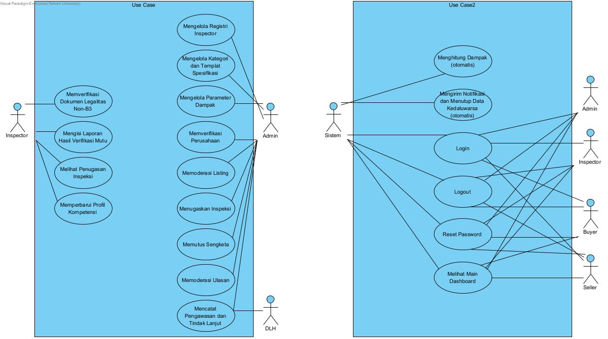

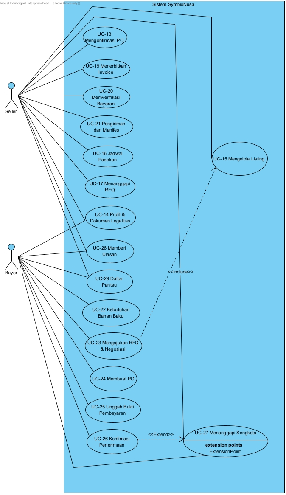

- Use Case Scenario

Skenario use case terperinci disusun untuk fungsi-fungsi yang mewakili alur bisnis utama dan memiliki aturan bisnis atau alur alternatif yang kompleks. Use case lainnya tetap tercakup dalam daftar dan diagram use case, dengan rincian skenario yang dapat dikembangkan lebih lanjut pada tahap implementasi.

UC-15: Mengelola Listing Sisa Produksi (Publikasi Listing)

| Aktor Utama | Seller |
|---|---|
| PBI Terkait | PBI-09 |
| Prakondisi | Seller sudah login dan perusahaannya berstatus Terverifikasi. |
| Pascakondisi | Listing tampil pada katalog dan dapat diajukan RFQ. |

Alur Utama (Main Flow):

1. Seller memilih menu Listing lalu Tambah Listing.

2. Sistem menampilkan formulir dan daftar kategori non-B3.

3. Seller memilih kategori; sistem memuat templat spesifikasi kategori tersebut.

4. Seller mengisi spesifikasi, volume (kg), harga per kg, lokasi, metode pembuangan sebelumnya, dan biaya buang per kg, lalu melampirkan bukti material (surat pernyataan non-B3, foto sampel, dan sertifikat laboratorium bila diwajibkan kategori).

5. Seller menyimpan sebagai draf; sistem memvalidasi kelengkapan parameter wajib.

6. Seller memilih Publikasikan; sistem mengubah status menjadi Published dan mengirim notifikasi ke pengguna yang daftar pantaunya cocok (UC-35).

Alur Alternatif (Alternative / Exception Flow):

3a. Kategori ditandai B3: Sistem menolak dan menampilkan pesan larangan.

5a. Parameter wajib kosong, volume tidak valid, atau lampiran wajib belum lengkap: Sistem menampilkan galat dan listing tidak dapat dipublikasikan.

6a. Perusahaan belum terverifikasi: Sistem menolak publikasi.

UC-23: Mengajukan RFQ dan Bernegosiasi

| Aktor Utama | Buyer (Utama), Seller |
|---|---|
| PBI Terkait | PBI-04 |
| Prakondisi | Buyer terverifikasi dan listing berstatus Published dengan stok tersedia. |
| Pascakondisi | Kontrak RFQ siap dijadikan PO (UC-24). |

Alur Utama (Main Flow):

1. Buyer membuka detail listing dari katalog dan memilih Ajukan RFQ.

2. Buyer mengisi volume, harga yang diajukan, dan tenggat; sistem memvalidasi volume tidak melebihi stok.

3. Sistem menyimpan RFQ berstatus Terbuka dan memberi notifikasi kepada Seller.

4. Seller membuka RFQ dan mengajukan penawaran balik (volume atau harga).

5. Buyer menyetujui penawaran balik.

6. Sistem mengubah status RFQ menjadi Disepakati dan mengunci harga serta volume pada kontrak RFQ.

Alur Alternatif (Alternative / Exception Flow):

4a. Seller menolak: Status Ditolak.

5a. Buyer menawar lagi: Kembali ke langkah 4 selama belum melewati batas putaran.

x. Tenggat terlewati tanpa tanggapan: Sistem menandai Kedaluwarsa.

3a. Buyer menarik RFQ sebelum ditanggapi: RFQ dihapus.

UC-18: Mengonfirmasi PO

| Aktor Utama | Seller |
|---|---|
| PBI Terkait | PBI-05 |
| Prakondisi | PO berstatus Menunggu Konfirmasi dari kontrak RFQ yang Disepakati. |
| Pascakondisi | Order siap diinspeksi. |

Alur Utama (Main Flow):

1. Seller membuka daftar PO masuk.

2. Seller memeriksa rincian PO, termasuk volume nominal, harga, serta toleransi tonase dan batas kadar air yang berlaku.

3. Seller memilih Konfirmasi.

4. Sistem mengunci baris listing, memeriksa stok masih mencukupi, mereservasi stok, dan mengubah status menjadi Dikonfirmasi dalam satu transaksi basis data.

5. Sistem mencatat perubahan pada riwayat status dan memberi notifikasi kepada Buyer dan Admin untuk penugasan inspeksi.

Alur Alternatif (Alternative / Exception Flow):

3a. Seller memilih Tolak dengan alasan: Status Ditolak dan stok tidak direservasi.

4a. Stok tidak mencukupi atau sudah direservasi PO lain: Sistem menolak konfirmasi dan meminta Seller memperbarui stok atau menolak PO.

x. Batas konfirmasi terlewati: PO otomatis Dibatalkan.

UC-10: Menugaskan Inspeksi

| Aktor Utama | Admin |
|---|---|
| PBI Terkait | PBI-18 (menggunakan data PBI-01) |
| Prakondisi | PO berstatus Dikonfirmasi. |
| Pascakondisi | Inspector menerima tugas pada daftar penugasannya. |

Alur Utama (Main Flow):

1. Admin membuka daftar order menunggu inspeksi.

2. Admin memilih order; sistem menampilkan Inspector aktif dengan bidang keahlian yang sesuai beserta rekomendasi mode verifikasi (Desk atau Lapangan) dan alasannya (risiko kategori, volume, riwayat Seller).

3. Admin menerima atau menimpa rekomendasi (alasan penimpaan dicatat), memilih Inspector (untuk mode Lapangan, daftar disaring menurut wilayah tugas), dan menetapkan jadwal.

4. Sistem memeriksa bentrok jadwal, menyimpan penugasan, mengubah status order menjadi Inspeksi, dan memberi notifikasi kepada Inspector.

Alur Alternatif (Alternative / Exception Flow):

2a. Tidak ada Inspector yang sesuai: Admin memperbarui registri (UC-05).

4a. Jadwal bentrok: Sistem menolak dan meminta jadwal lain.

5. Admin dapat menugaskan ulang atau membatalkan penugasan sebelum laporan final.

UC-30 & UC-31: Memverifikasi Dokumen Legalitas dan Mutu

| Aktor Utama | Inspector |
|---|---|
| PBI Terkait | PBI-17 dan PBI-19 |
| Prakondisi | Order berstatus Inspeksi dan ditugaskan kepada Inspector tersebut. |
| Pascakondisi | Hasil menjadi syarat penerbitan invoice (bila lulus) dan pengiriman. |

Alur Utama (Main Flow):

1. Inspector membuka penugasan; sistem menampilkan dokumen perusahaan (PBI-08), bukti pada listing (PBI-09), dan mode verifikasi.

2. Inspector menelaah tiap dokumen memakai checklist dan memilih Setuju atau Tolak (dengan alasan).

3. Verifikasi mutu: Pada mode Desk, Inspector menilai kesesuaian foto sampel, sertifikat laboratorium, dan data parameter terhadap templat kategori; pada mode Lapangan, Inspector mengisi hasil pemeriksaan yang dilakukan di luar platform beserta lampiran.

4. Sistem menilai tiap parameter terhadap ambang pada templat (termasuk kadar air maksimum) dan menetapkan hasil Lulus atau Gagal.

5. Inspector memeriksa ringkasan dan memfinalisasi laporan.

6. Sistem mengubah status order menjadi Lolos Inspeksi atau Gagal Inspeksi dan memberi notifikasi kepada Seller, Buyer, dan Admin.

Alur Alternatif (Alternative / Exception Flow):

2a. Dokumen ditolak: Seller diminta memperbarui dokumen atau lampiran dan verifikasi diulang.

3a. Bukti pada mode Desk tidak memadai: Inspector meminta Admin mengubah ke mode Lapangan.

5a. Laporan masih draf: Inspector dapat merevisi sebelum final.

6a. Gagal Inspeksi: Seller merevisi dan Admin menjadwalkan inspeksi ulang, atau order dibatalkan.

UC-25 & UC-20: Mengunggah dan Memverifikasi Bukti Pembayaran

| Aktor Utama | Buyer dan Seller |
|---|---|
| PBI Terkait | PBI-07 (Invoice dari PBI-06) |
| Prakondisi | Invoice telah diterbitkan dan belum dibayar. |
| Pascakondisi | Seller dapat membuat pengiriman. |

Alur Utama (Main Flow):

1. Buyer membuka invoice dan memilih Unggah Bukti.

2. Buyer mengisi tanggal transfer, nominal, dan rekening asal, lalu mengunggah berkas.

3. Sistem memvalidasi tipe dan ukuran berkas serta kesesuaian nominal.

4. Seller membuka bukti dan memilih Verifikasi.

5. Sistem mengubah status pembayaran menjadi Valid dan status order menjadi Dibayar.

Alur Alternatif (Alternative / Exception Flow):

3a. Nominal tidak sama dengan invoice: Sistem menolak.

4a. Seller menolak bukti dengan alasan: Buyer mengunggah ulang.

2a. Buyer menghapus bukti yang salah sebelum diverifikasi.

UC-26: Mengonfirmasi Penerimaan Barang

| Aktor Utama | Buyer |
|---|---|
| PBI Terkait | PBI-12 |
| Prakondisi | Pengiriman berstatus Tiba. |
| Pascakondisi | Volume aktual tercatat sebagai dasar dampak. |

Alur Utama (Main Flow):

1. Buyer membuka pengiriman dan memilih Konfirmasi Penerimaan.

2. Buyer mengisi berat diterima, berat ditolak, kadar air (bila disyaratkan kategori), kondisi, dan catatan.

3. Sistem memvalidasi bahwa jumlah diterima ditambah ditolak tidak melampaui berat dikirim ditambah toleransi penimbangan.

4. Sistem mengevaluasi hasil terhadap toleransi tonase dan kadar air pada PO.

5. Bila dalam toleransi, sistem mengubah status order menjadi Selesai, mencatat nilai final dan nota penyesuaian, memicu perhitungan dampak (UC-34), dan membuka fitur ulasan.

Alur Alternatif (Alternative / Exception Flow):

5a. Di luar toleransi: Sistem membuka tiket sengketa otomatis, status order menjadi Sengketa, dan alur berlanjut ke UC-27.

2a. Salah isi: Buyer mengoreksi dalam jendela koreksi 24 jam.

2b. Buyer menilai mutu tidak sesuai meskipun berat dalam toleransi: Buyer dapat mengajukan sengketa secara manual (UC-27) dalam batas waktu pelaporan.

UC-27: Mengajukan dan Menanggapi Sengketa

| Aktor Utama | Buyer atau Seller (Pelapor), Admin |
|---|---|
| PBI Terkait | PBI-13 |
| Prakondisi | Order berstatus Diterima dan masih dalam batas waktu pelaporan. |
| Pascakondisi | Sengketa terdokumentasi dan order ditutup. |

Alur Utama (Main Flow):

1. Pelapor membuat tiket sengketa dengan jenis, deskripsi, dan bukti.

2. Sistem mencatat tiket berstatus Dibuka dan memberi notifikasi kepada pihak lawan dan Admin.

3. Pihak lawan menanggapi dengan bukti.

4. Admin meninjau kedua pihak dan memutus penyelesaian.

5. Sistem menerapkan putusan, mengubah status order menjadi Selesai atau Dibatalkan, dan menutup tiket.

Alur Alternatif (Alternative / Exception Flow):

2a. Pelapor menarik tiket sebelum ditanggapi: Tiket dihapus dan order kembali ke penyelesaian normal.

1a. Melewati batas waktu pelaporan: Sistem menolak pembuatan tiket.

## Arsitektur Sistem

- Gambaran Arsitektur

SymbioNusa menerapkan arsitektur client-server berlapis dengan pola MVC (Model-View-Controller) yang diimplementasikan menggunakan kerangka kerja Laravel 11 (PHP 8.2+). Aplikasi dibangun sebagai modular monolith ber-render sisi server (Server-Side Rendering): antarmuka dibuat menggunakan Blade dan komponen interaktif Livewire 3, logika bisnis diisolasi pada kelas Service/Action, dan manipulasi data dikelola oleh Eloquent ORM pada basis data MySQL 8.0 (menggunakan storage engine InnoDB dan tipe kolom JSON).

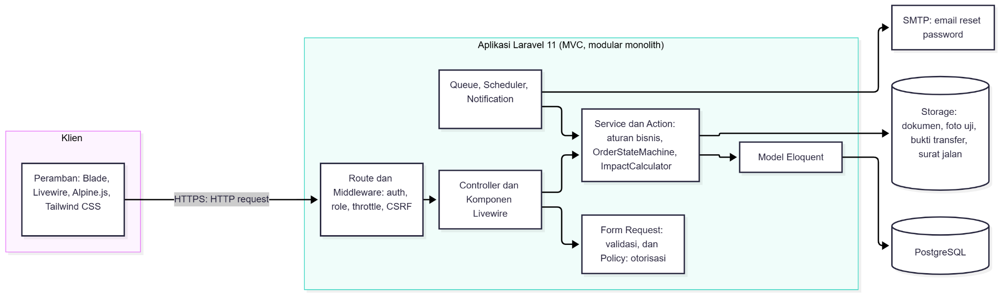

Link PNG Arsitektur Sistem

Alur pemrosesan permintaan pada sistem adalah sebagai berikut:

- Peramban mengirimkan permintaan HTTP/HTTPS ke server web.

- Route dan middleware memeriksa sesi autentikasi (auth), otorisasi peran (role), pembatasan laju (rate limiting/throttle), dan keamanan token CSRF.

- Controller atau komponen Livewire menerima permintaan, memicu Form Request untuk validasi masukan serta Policy untuk otorisasi aksi.

- Kelas Service/Action mengeksekusi logika bisnis inti, termasuk pemanggilan OrderStateMachine untuk memvalidasi transisi status transaksi.

- Model Eloquent melakukan operasi baca/tulis ke basis data MySQL 8.0 (dengan transaksi atomik DB::transaction untuk operasi lintas tabel), sementara berkas digital disimpan melalui Storage.

- Server mengembalikan respons berupa tampilan Blade/Livewire, atau data JSON untuk kebutuhan dasbor analitik.

- Proses asinkron dan tugas pemeliharaan berkala (notifikasi, kedaluwarsa RFQ, penutupan kebutuhan) ditangani oleh Queue Worker dan Laravel Scheduler.

- Struktur Modul Aplikasi

Aplikasi dibagi menjadi 10 domain modul internal untuk menjaga keterpisahan tanggung jawab (separation of concerns) dan memudahkan pengembangan secara end-to-end oleh tim:

| Modul (Domain) | Cakupan Fungsi | PBI Terkait |
|---|---|---|
| Auth | Login, logout, reset password, middleware peran, dan isolasi company_id | FND-01 s.d. FND-03 |
| Master | Master kategori, templat spesifikasi, registri Inspector, dan parameter dampak | PBI-01, PBI-02, PBI-03 |
| Company | Profil perusahaan, dokumen legalitas, dan verifikasi mitra | PBI-08 |
| Catalog | Listing sisa produksi, jadwal pasokan, kebutuhan bahan baku, dan daftar pantau | PBI-09, PBI-10, PBI-14, PBI-16 |
| Transaction | RFQ dan negosiasi, Purchase Order (PO), invoice, dan verifikasi pembayaran | PBI-04 s.d. PBI-07 |
| Logistics | Pengiriman, manifes angkut, penerimaan barang, dan penanganan sengketa | PBI-11, PBI-12, PBI-13 |
| Inspection | Penugasan inspeksi, verifikasi dokumen non-B3, dan laporan hasil mutu | PBI-17, PBI-18, PBI-19 |
| Oversight | Pengawasan kepatuhan DLH dan ulasan mitra | PBI-15, PBI-20 |
| Impact | Perhitungan dan agregasi dampak lingkungan dan ekonomi (impact_logs) | Mesin Dampak, FND-04 |
| Notification & Audit | Notifikasi in-app interaktif dan rekam jejak audit (audit trail) | Lintas Modul |

- Mesin Status Order (State Machine)

Siklus hidup transaksi B2B dikendalikan oleh service OrderStateMachine menggunakan PHP Enum OrderStatus. Mekanisme ini memastikan transisi status terjadi secara teratur dan menolak transisi yang tidak sah.

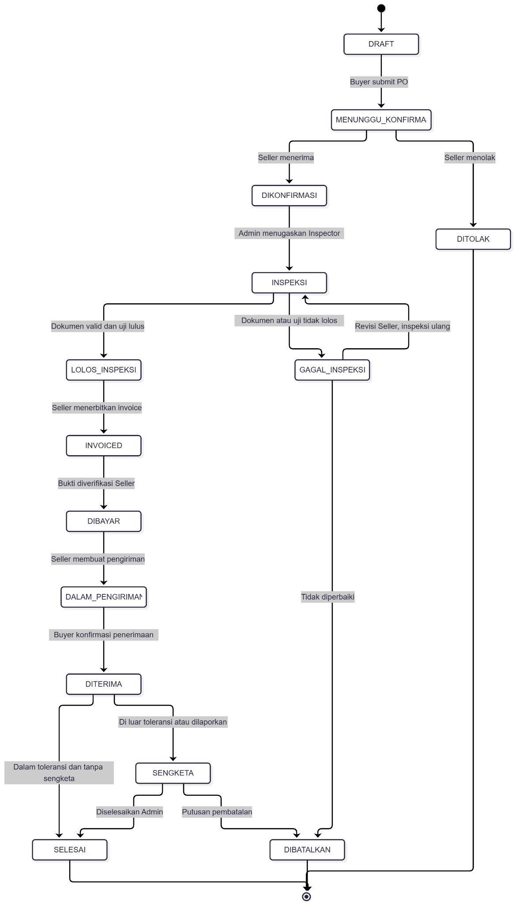

Link PNG State Order Machine

- Analisis Pemilihan Arsitektur dan Platform Berdasarkan Literatur

Pemilihan komponen arsitektur dan platform teknis SymbioNusa didasarkan pada tinjauan literatur rekayasa perangkat lunak:

- Client-server berlapis dan MVC. Arsitektur berlapis memisahkan tanggung jawab presentasi, logika bisnis, dan akses data sehingga setiap lapisan dapat diubah atau diuji secara terpisah, dan merupakan pola yang lazim untuk sistem informasi transaksional. Pola MVC memisahkan model data, tampilan, dan pengendali. Laravel mengimplementasikan MVC secara langsung, sehingga selaras dengan fokus mata kuliah PPL dan memudahkan pemetaan rancangan (use case, class diagram) ke kode.

- Aplikasi ber-render sisi server, bukan SPA terpisah. Dengan Blade dan Livewire 3, tampilan dan logika berada dalam satu basis kode; validasi tidak perlu diduplikasi pada frontend dan backend, dan tidak diperlukan lapisan API terpisah untuk setiap halaman. Autentikasi berbasis sesi dengan proteksi CSRF bawaan lebih sederhana dan aman dibanding mengelola token pada klien. Livewire memberi interaktivitas yang dibutuhkan (utas RFQ, filter katalog, notifikasi) tanpa membangun SPA. Pilihan ini mengurangi kompleksitas integrasi bagi tim enam orang dengan tenggat satu semester.

- Gaya REST pada pengelolaan sumber daya. Rute memakai resource controller sehingga setiap sumber daya memiliki URI sendiri dan operasi CRUD dipetakan ke metode HTTP yang sesuai; endpoint JSON untuk data dasbor dan notifikasi mengikuti prinsip antarmuka seragam dan tanpa status.

- Modular monolith, bukan microservices. Satu unit deploy dengan modul yang terpisah jelas per domain mengurangi beban operasional (jaringan antarlayanan, orkestrasi, dan konsistensi data terdistribusi). Pendekatan "monolit lebih dulu" yang dimodularisasi umumnya dianjurkan sebelum domain dan batas layanan benar-benar dipahami. Karena modul sudah dipisah per domain, migrasi ke layanan terpisah tetap memungkinkan di masa depan.

- Basis data relasional. Domain transaksi B2B bergantung pada integritas antar-entitas (PO, invoice, pembayaran, pengiriman) dan operasi atomik, sehingga basis data relasional dengan transaksi ACID (MySQL 8.0 dengan storage engine InnoDB) lebih tepat dibanding penyimpanan dokumen. Kolom JSON dipakai terbatas untuk spesifikasi material yang bervariasi per kategori, dan skema dikelola dengan migrasi Eloquent.

- Pengendalian akses. RBAC dipilih karena peran pengguna sudah jelas dan berbeda secara fungsional; implementasinya memakai middleware peran dan Policy, ditambah global scope company_id untuk isolasi data antar-perusahaan.

- Ekosistem Laravel yang lengkap. Fondasi autentikasi (Breeze), notifikasi, antrean, penjadwalan tugas, penyimpanan berkas, dan validasi tersedia bawaan sehingga kebutuhan seperti login, notifikasi in-app, dan kedaluwarsa otomatis tidak perlu dibangun dari nol. Hal ini mengurangi kode kustom dan risiko keamanan, serta didukung dokumentasi dan komunitas yang luas. Platform web dipilih dibanding aplikasi native karena pengguna adalah perusahaan yang bekerja melalui komputer kantor dan mengisi formulir serta berkas yang panjang; desain responsif tetap memungkinkan akses dari ponsel untuk tugas ringan seperti Inspector di lapangan.

## Rancangan ERD

Perancangan basis data SymbioNusa terdiri dari 29 entitas/tabel yang dikelompokkan ke dalam 7 domain fungsional utama. Seluruh entitas saling terhubung menggunakan relasi Non-Identifying dengan kepatuhan pada aturan Foreign Key (FK) dan batasan integritas data (Unique Constraints & Nullable Nullability).

- ERD

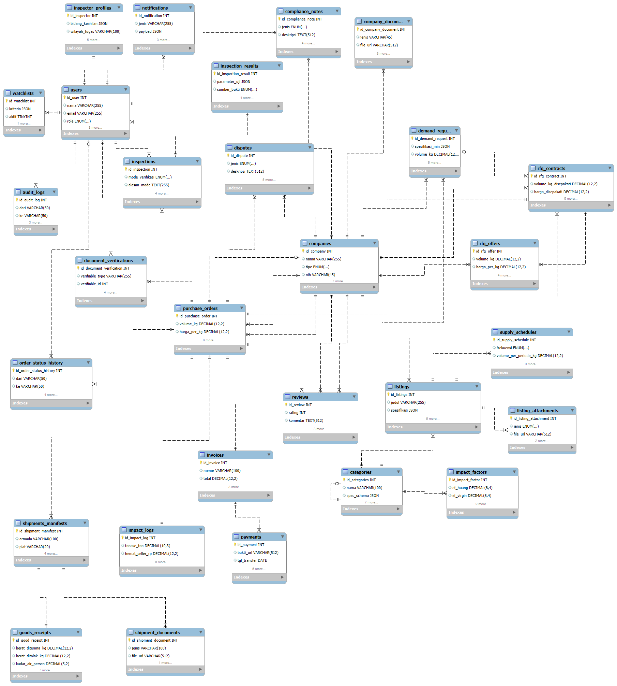

Link PNG ERD

- Penjelasan Tabel dan Relasi Basis Data

| No | Entitas / Tabel | Atribut Utama & Tipe Data | Relasi Utama (Parent → Child) | Deskripsi Fungsional & Modul/PBI |
|---|---|---|---|---|
| 1 | companies | id_company (PK), nama, tipe (SELLER/BUYER/KEDUANYA), nib (UNIQUE), alamat, kontak, status_verifikasi | 1 : N ke users, listings, demand_requests, company_documents, compliance_notes | Menyimpan data profil perusahaan mitra B2B serta status verifikasi legalitasnya oleh Admin (PBI-08). |
| 2 | users | id_user (PK), id_company (FK, Nullable), nama, email (UNIQUE), role (ADMIN/SELLER/BUYER/INSPECTOR), status | N : 1 ke companies 1 : 1 ke inspector_profiles 1 : N ke inspections, watchlists, notifications, audit_logs | Menyimpan data akun pengguna platform beserta peran (role) dan tautan ke perusahaan (FND-01 s.d. FND-03). |
| 3 | company_documents | id_company_document (PK), id_company (FK), jenis, file_url, berlaku_sampai, status | N : 1 ke companies | Menyimpan berkas legalitas perusahaan (NIB, SIUP, AMDAL) untuk diverifikasi Admin (PBI-08). |
| 4 | categories | id_categories (PK), categories_id_categories (FK Self-Ref, Nullable), nama, spec_schema (JSON), is_b3_prohibited, tingkat_risiko | 1 : N ke dirinya sendiri (Hierarki Kategori) 1 : N ke listings, demand_requests, impact_factors | Menyimpan hierarki kategori sisa produksi non-B3, skema templat spesifikasi, dan ambang mutu (PBI-02). |
| 5 | inspector_profiles | id_inspector (PK), id_user (FK, UNIQUE), bidang_keahlian (JSON), wilayah_tugas, no_sertifikat, status_aktif | 1 : 1 ke users | Menyimpan profil sertifikasi, bidang keahlian, dan wilayah tugas pengguna berperan Inspector (PBI-01). |
| 6 | impact_factors | id_impact_factor (PK), categories_id_categories (FK, UNIQUE), ef_buang, ef_virgin, ef_proses, ef_trans, versi (UNIQUE) | N : 1 ke categories | Menyimpan variabel perhitungan efisiensi biaya dan emisi CO2e per kategori material (PBI-03). |
| 7 | listings | id_listings (PK), companies_id_company (FK), categories_id_categories (FK), judul, spesifikasi (JSON), volume_kg, stok_kg, harga_per_kg, status | N : 1 ke companies, categories 1 : N ke listing_attachments, supply_schedules, rfq_contracts | Menyimpan penawaran katalog sisa produksi dari Seller beserta detail volume dan lokasi (PBI-09). |
| 8 | listing_attachments | id_listing_attachment (PK), listings_id_listings (FK), jenis (SURAT_NON_B3/FOTO_SAMPEL/SERTIFIKAT_LAB), file_url, status | N : 1 ke listings | Menyimpan berkas bukti foto sampel dan dokumen bebas B3 pendukung pasokan material (PBI-09). |
| 9 | supply_schedules | id_supply_schedule (PK), listings_id_listings (FK), frekuensi (MINGGUAN/BULANAN), volume_per_periode_kg, mulai, selesai, status | N : 1 ke listings | Menyimpan proyeksi jadwal pasokan sisa produksi yang dihasilkan secara rutin oleh Seller (PBI-10). |
| 10 | demand_requests | id_demand_request (PK), companies_id_company (FK), categories_id_categories (FK), spesifikasi_min (JSON), volume_kg, harga_maks, status | N : 1 ke companies, categories 1 : N ke rfq_contracts (Nullable) | Menyimpan postingan papan kebutuhan bahan baku sekunder yang dicari oleh Buyer (PBI-14). |
| 11 | rfq_contracts | id_rfq_contract (PK), listings_id_listings (FK), companies_id_company (FK), demand_requests_id_demand_request (FK, Nullable), volume_kg_disepakati, harga_disepakati, status | N : 1 ke listings, companies, demand_requests 1 : N ke rfq_offers 1 : 1 ke purchase_orders | Menyimpan kesepakatan negosiasi penawaran (RFQ) antar-mitra sebelum menjadi kontrak resmi (PBI-04). |
| 12 | rfq_offers | id_rfq_offer (PK), rfq_contracts_id_rfq_contract (FK), companies_id_company (FK), volume_kg, harga_per_kg, urutan | N : 1 ke rfq_contracts, companies | Menyimpan riwayat utas penawaran dan kontra-penawaran volume/harga selama proses RFQ (PBI-04). |
| 13 | purchase_orders | id_purchase_order (PK), rfq_contracts_id_rfq_contract (FK, UNIQUE), companies_id_seller (FK), companies_id_buyer (FK), volume_kg, harga_per_kg, status | 1 : 1 ke rfq_contracts, invoices, impact_logs 1 : N ke shipments_manifests, inspections, document_verifications, disputes, reviews, order_status_history | Entitas utama kontrak transaksi resmi B2B setelah negosiasi disetujui kedua belah pihak (PBI-05). |
| 14 | invoices | id_invoice (PK), purchase_orders_id_purchase_order (FK, UNIQUE), nomor (UNIQUE), total, jatuh_tempo, status | 1 : 1 ke purchase_orders 1 : N ke payments | Menyimpan dokumen tagihan pembayaran resmi yang diterbitkan berdasarkan kontrak PO (PBI-06). |
| 15 | payments | id_payment (PK), invoices_id_invoice (FK), bukti_url, tgl_transfer, nominal, status_verifikasi | N : 1 ke invoices | Menyimpan catatan pelunasan dan bukti transfer bank dari Buyer untuk diverifikasi Seller (PBI-07). |
| 16 | shipments_manifests | id_shipment_manifest (PK), purchase_orders_id_purchase_order (FK), no_manifes (UNIQUE), armada, plat, sopir, berat_dikirim_kg, status | N : 1 ke purchase_orders 1 : N ke shipment_documents 1 : 1 ke goods_receipts | Menyimpan data pengiriman logistik, kendaraan pengangkut, dan manifes angkut (PBI-11). |
| 17 | shipment_documents | id_shipment_document (PK), shipments_manifests_id_shipment_manifest (FK), jenis, file_url | N : 1 ke shipments_manifests | Menyimpan berkas fisik pendukung pengiriman seperti lampiran surat jalan fisik (PBI-11). |
| 18 | goods_receipts | id_good_receipt (PK), shipments_manifests_id_shipment_manifest (FK, UNIQUE), berat_diterima_kg, berat_ditolak_kg, status_toleransi, nilai_penyesuaian_rp, waktu | 1 : 1 ke shipments_manifests | Menyimpan Berita Acara Penerimaan Barang (BAPB) serta evaluasi selisih berat/kadar air (PBI-12). |
| 19 | disputes | id_dispute (PK), purchase_orders_id_purchase_order (FK), companies_id_company (FK), jenis, bukti_url, status, putusan | N : 1 ke purchase_orders, companies | Menyimpan tiket laporan klaim sengketa jika terjadi ketidaksesuaian tonase atau mutu material (PBI-13). |
| 20 | inspections | id_inspection (PK), purchase_orders_id_purchase_order (FK), users_id_user (FK Inspector), mode_verifikasi (DESK/LAPANGAN), status | N : 1 ke purchase_orders, users 1 : 1 ke inspection_results | Menyimpan penugasan jadwal verifikasi mutu material oleh Inspector independen (PBI-18). |
| 21 | inspection_results | id_inspection_result (PK), inspections_id_inspection (FK, UNIQUE), parameter_uji (JSON), sumber_bukti, hasil (LULUS/GAGAL), status | 1 : 1 ke inspections | Menyimpan Laporan Hasil Pemeriksaan (LHP) mutu teknis dan uji laboratorium material (PBI-19). |
| 22 | document_verifications | id_document_verification (PK), purchase_orders_id_purchase_order (FK), users_id_user (FK Inspector), checklist (JSON), status | N : 1 ke purchase_orders, users | Menyimpan rekam verifikasi dokumen legalitas non-B3 oleh Inspector sebagai syarat transaksi (PBI-17). |
| 23 | compliance_notes | id_compliance_note (PK), companies_id_company (FK), users_id_user (FK Admin/DLH), jenis, tenggat, status_tindak_lanjut | N : 1 ke companies, users | Menyimpan catatan temuan pengawasan lingkungan dan surat peringatan bagi perusahaan (PBI-20). |
| 24 | reviews | id_review (PK), purchase_orders_id_purchase_order (FK), companies_id_company (FK Penulis), companies_id_target_company (FK Target), rating, komentar | N : 1 ke purchase_orders, companies | Menyimpan penilaian bintang dan ulasan reputasi antar-mitra setelah transaksi selesai (PBI-15). |
| 25 | impact_logs | id_impact_log (PK), purchase_orders_id_purchase_order (FK, UNIQUE), tonase_ton, hemat_seller_rp, hemat_buyer_rp, co2e_net_kg | 1 : 1 ke purchase_orders | Menyimpan hasil perhitungan otomatis dampak lingkungan dan penghematan biaya secara permanen (Mesin Dampak). |
| 26 | watchlists | id_watchlist (PK), users_id_user (FK), kriteria (JSON), aktif | N : 1 ke users | Menyimpan kriteria kata kunci/material yang dipantau pengguna untuk pemicu notifikasi otomatis (PBI-16). |
| 27 | order_status_history | id_order_status_history (PK), purchase_orders_id_purchase_order (FK), users_id_user (FK, Nullable), dari, ke, alasan, waktu | N : 1 ke purchase_orders, users | Merekam kronologi audit (audit trail) transisi status kontrak PO dari draf hingga selesai (Sistem). |
| 28 | audit_logs | id_audit_log (PK), users_id_user (FK, Nullable), aksi, auditable_type, auditable_id, nilai_lama (JSON), nilai_baru (JSON) | N : 1 ke users | Rekam jejak aktivitas sistem dan perubahan data sensitif oleh Admin/pengguna untuk transparansi (Sistem). |
| 29 | notifications | id_notification (PK), users_id_user (FK), jenis, payload (JSON), read_at, created_at | N : 1 ke users | Pusat penampungan pesan pemberitahuan interaktif pengguna (in-app notification) (Lintas Modul). |

## Class Diagram

Class diagram menggambarkan struktur statis sistem SymbioNusa dengan memetakan entitas data, domain bisnis, serta kelas layanan (services) beserta atribut, metode, dan keterkaitan antar kelas. Perancangan kelas dibagi menjadi 5 modul utama dan 1 lapisan layanan bisnis (business logic layer).

- Visualisasi Class Diagram

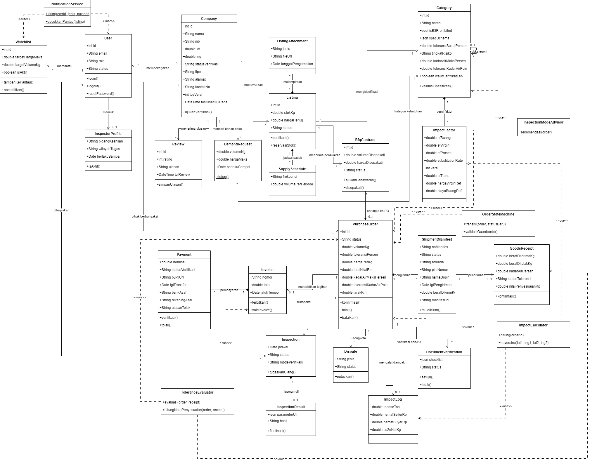

Link PNG Class Diagram

- Penjelasan Modul dan Entitas Kelas

- Modul Pengguna & Profil (User & Core Management)

- Company: Menyimpan data profil entitas bisnis B2B (perusahaan penghasil/pengolah limbah), mencakup data legalitas (NIB), koordinat lokasi (lat/lng), status verifikasi, dan persetujuan ToS.

- User: Menyimpan kredensial autentikasi pengguna, peran (role), dan status akun yang terhubung ke Company atau InspectorProfile.

- InspectorProfile: Menyimpan data kredensial dan wilayah operasional verifikator/inspektur lapangan.

- Review: Menampung ulasan dan rating performa antar perusahaan setelah transaksi selesai.

- Watchlist: Menyimpan preferensi pemantauan stok limbah berdasarkan target harga dan volume untuk pengiriman notifikasi otomatis.

- Modul Katalog & Penawaran (Marketplace & Catalog)

- Category: Mengelola taksonomi limbah non-B3, parameter batas kadar air, toleransi susut, serta skema spesifikasi teknis (JSON schema).

- Listing: Mengelola penawaran stok limbah aktif yang diunggah oleh Seller, mencakup kuantitas, harga dasar per kg, dan status ketersediaan.

- ListingAttachment: Menampung berkas pendukung listing (foto material, dokumen hasil uji laboratorium awal).

- SupplySchedule: Mengatur frekuensi dan perkiraan volume pasok limbah secara berulang (recurring supply).

- DemandRequest: Menampung permintaan kebutuhan bahan baku limbah dari pihak Buyer.

- RfqContract: Mengelola kesepakatan negosiasi harga dan volume antara Buyer dan Seller sebelum diterbitkan menjadi pesanan resmi.

- Modul Transaksi & Operasional (Order & Transaction)\

- PurchaseOrder: Entitas utama kontrak transaksi B2B yang mengunci volume, harga, toleransi batas kualitas, total nilai transaksi, dan jarak pengiriman.

- Invoice: Mengelola tagihan pembayaran berbasis termin atau pelunasan penuh.

- Payment: Mengelola rekaman bukti transfer, verifikasi pembayaran, dan validasi akun bank.

- ShipmentManifest: Mengelola informasi logistik pengiriman, mencakup nomor manifes, armada, nama sopir, pelat nomor, dan berat awal kirim.

- GoodsReceipt: Mengelola pencatatan penerimaan barang di lokasi Buyer, mencakup penimbangan ulang berat aktual, pengujian kadar air, dan perhitungan nilai penyesuaian (adjustment).

- Dispute: Mengelola penanganan klaim dan sengketa transaksi jika terjadi ketidaksesuaian di luar batas toleransi.

- Modul Verifikasi & Dampak Lingkungan (Verification & Impact)

- Inspection: Mengelola penjadwalan dan penetapan mode verifikasi (lapangan atau dokumen).

- InspectionResult: Menampung hasil parameter pengujian teknis material secara aktual dari inspektur.

- DocumentVerification: Mengelola checklist dan validasi dokumen legalitas/non-B3.

- ImpactLog: Mencatat histori kalkulasi dampak lingkungan riil per transaksi (tonase limbah terolah, penghematan biaya Seller/Buyer, dan estimasi penurunan emisi `CO2e` ).

- ImpactFactor: Mengisi kon Koefisien emisi dan indeks biaya referensi material virgin vs limbah per kategori.

- Lapangan Layanan Logika Bisnis (Service Layer)

- OrderStateMachine: Mengontrol alur perubahan status PurchaseOrder secara terstruktur dengan validasi aturan guard.

- ImpactCalculator: Menghitung estimasi rute jarak (formula Haversine) serta kalkulasi numerik dampak lingkungan dan penghematan ekonomi.

- ToleranceEvaluator: Menganalisis selisih berat/kadar air pada GoodsReceipt terhadap kriteria PurchaseOrder untuk menentukan nota penyesuaian harga.

- InspectionModeAdvisor: Menganalisis tingkat risiko kategori limbah dan riwayat transaksi untuk merekomendasikan mode inspeksi.

- NotificationService: Mengirim notifikasi otomatis ke pengguna saat terjadi perubahan status transaksi atau kecocokan stok di Watchlist.

- Penjelasan Arsitektur Relasi Kunci

| Tipe Relasi | Kelas Asal | Kelas Tujuan | Keterangan |
|---|---|---|---|
| Composition (◆) | Listing | ListingAttachment, SupplySchedule | Berkas dan jadwal pasok terikat penuh pada eksistensi Listing. |
| Composition (◆) | PurchaseOrder | ShipmentManifest | Manifes pengiriman merupakan bagian tak terpisahkan dari PurchaseOrder. |
| Composition (◆) | Invoice | Payment | Transaksi pembayaran melekat langsung pada entitas Invoice. |
| Aggregation (◇) | Category | Listing, DemandRequest | Category mengelompokkan Listing dan DemandRequest tanpa menghapus data kategori jika listing ditutup. |
| Self-Association | Category | Category | Membentuk struktur hirarki subkategori limbah. |
| Dependency (<<use>>) | OrderStateMachine | PurchaseOrder | Layanan mengontrol transisi status transaksi. |
| Dependency (<<use>>) | ToleranceEvaluator | PurchaseOrder, GoodsReceipt, Invoice | Layanan mengevaluasi susut/kadar air untuk menentukan harga akhir invoice. |

## Mockup

App Shell & Dashboard Admin (FND-04)

Antarmuka utama yang menyajikan ringkasan kinerja platform secara real-time, meliputi metrik akumulasi dampak lingkungan (tonase terdaur ulang, penghematan biaya, dan emisi `CO2e` yang ditekan), grafik tren bulanan, antrean tindakan operasional, serta kartu ringkasan status dari masing-masing modul.

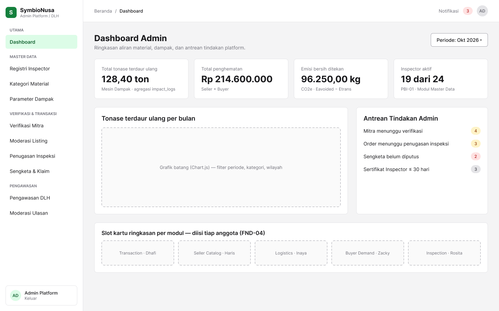

PBI-01 Registri Inspector - Daftar Registri Inspector

Halaman tabel data untuk memantau, menyaring, dan mengelola seluruh Inspector terdaftar, dilengkapi kartu indikator ringkasan status serta label keaktifan sertifikat (Aktif, Segera Berakhir, Nonaktif).

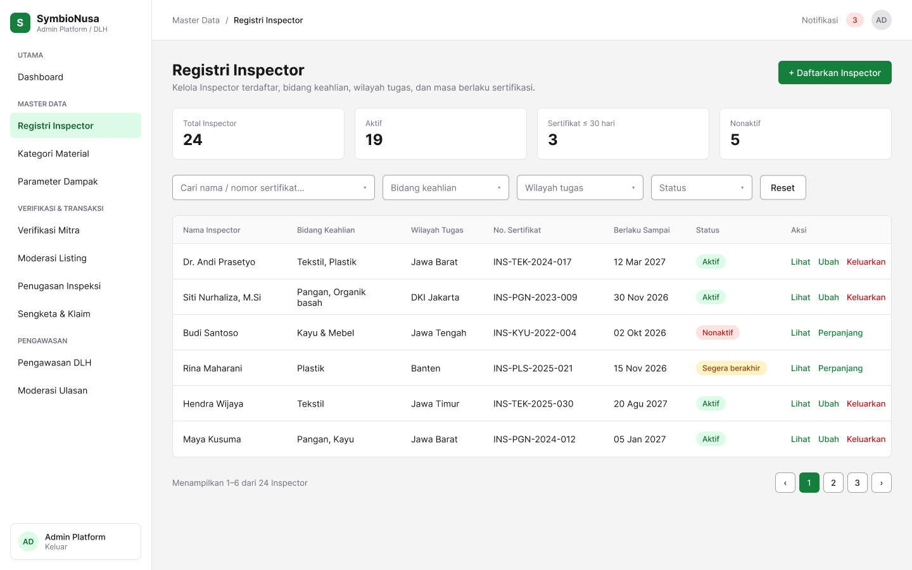

PBI-01 Registri Inspector-Form Daftarkan Inspector

Halaman formulir penuh untuk mendaftarkan Inspector baru dengan menghubungkan akun pengguna, menentukan bidang keahlian kategori material, wilayah tugas operasional, serta melampirkan berkas sertifikasi kompetensi.

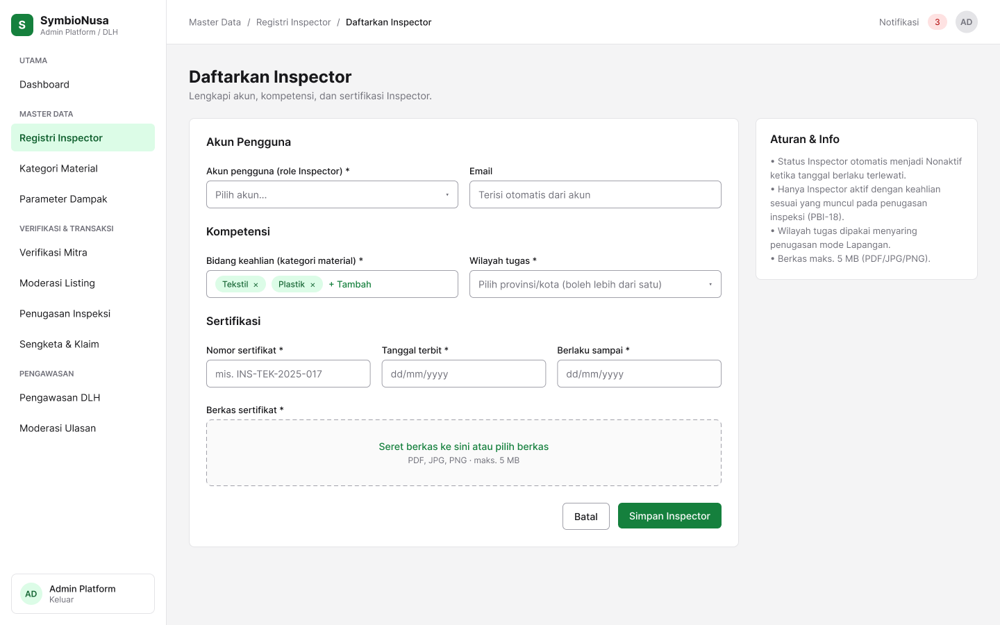

PBI-02 Kategori Material & Templat Spesifikasi

Antarmuka dua panel (split-view) untuk mengelola struktur hierarki kategori limbah non-B3, menandai/memblokir kategori B3, menetapkan batas toleransi (tonase dan kadar air), serta menyusun templat parameter spesifikasi teknis dinamis yang wajib diisi oleh Seller.

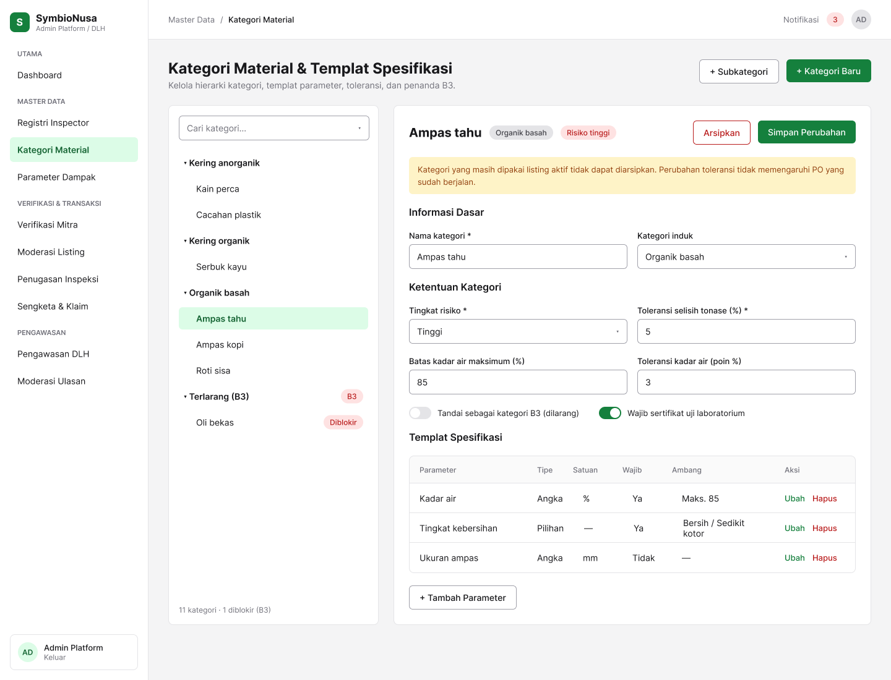

PBI-03 Parameter Dampak & Faktor Emisi - Daftar Versi Faktor Emisi

Halaman tabel untuk mengelola riwayat dan transparansi versi parameter dampak per kategori material (faktor emisi pembuangan, bahan baku primer, pemrosesan, angkutan, dan substitution rate) yang digunakan oleh ImpactCalculator.

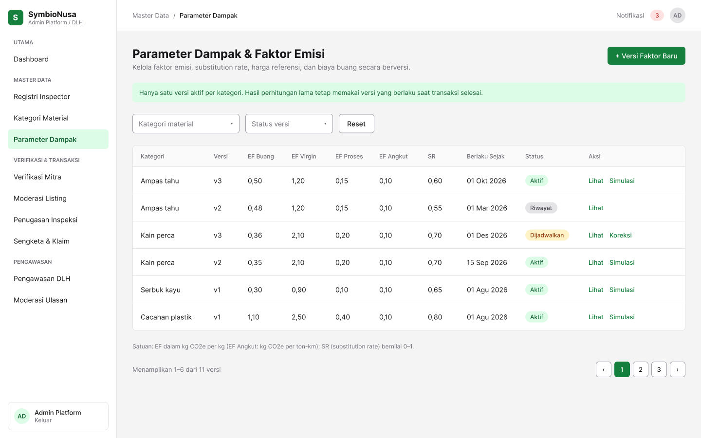

PBI-03 Parameter Dampak & Faktor Emisi - Form Versi Baru & Simulasi Pratinjau

Halaman input pembuatan versi faktor emisi baru yang dilengkapi panel simulasi pratinjau interaktif untuk menguji estimasi penghematan biaya (Rp) dan penekanan emisi (CO2​e) berdasarkan contoh volume dan jarak sebelum versi diaktifkan.

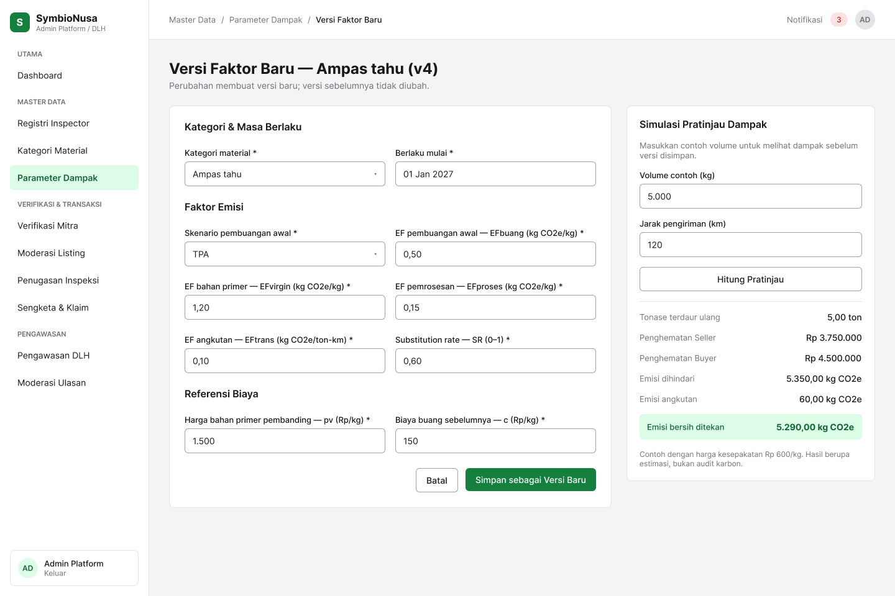

PBI-04 Daftar RFQ (Buyer)

Halaman ini menyajikan daftar Request for Quotation (RFQ) dan pengajuan negosiasi harga bagi Buyer. Di dalamnya terdapat kartu informasi statistik, kolom pencarian, filter status dan kategori material, serta tabel daftar RFQ yang memuat tombol aksi seperti Lihat, Tarik, dan Buat PO.

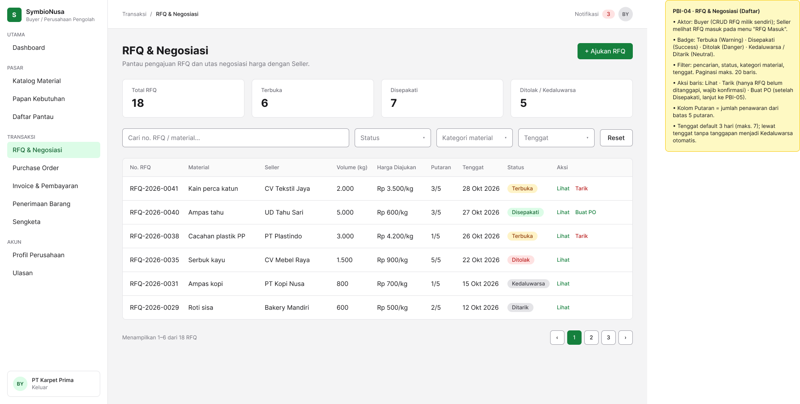

PBI-04 Form Ajukan RFQ (Buyer)

Halaman ini menyediakan formulir bagi Buyer untuk mengajukan permintaan penawaran harga dan volume baru dari listing material. Fiturnya mencakup pemilihan material dari katalog dengan pengisian otomatis data seller serta bagian rincian penawaran dan catatan opsional.

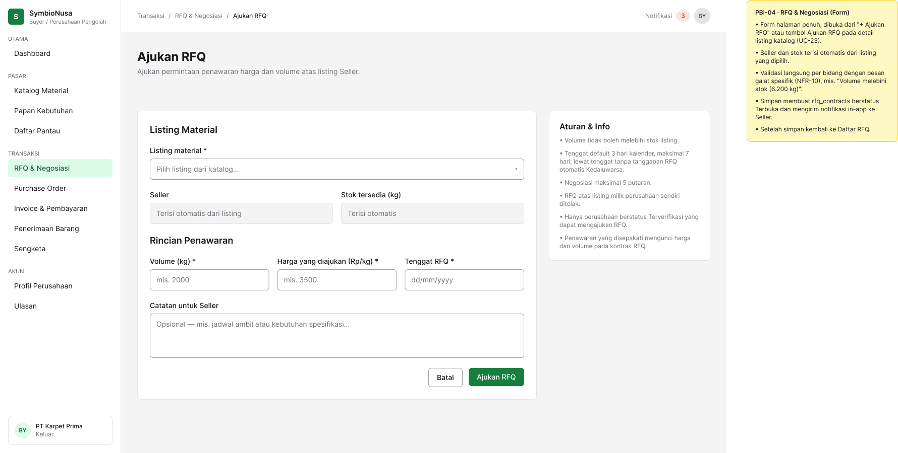

PBI-04 Detail FRQ dan Utas Negosiasi (Seller)

Halaman ini menampilkan detail utas negosiasi harga dan volume antara Buyer dan Seller untuk nomor RFQ tertentu. Halaman memuat riwayat utas interaktif serta form tanggapan penawaran bagi pengguna untuk memasukkan volume, harga penawaran balik, atau alasan penolakan.

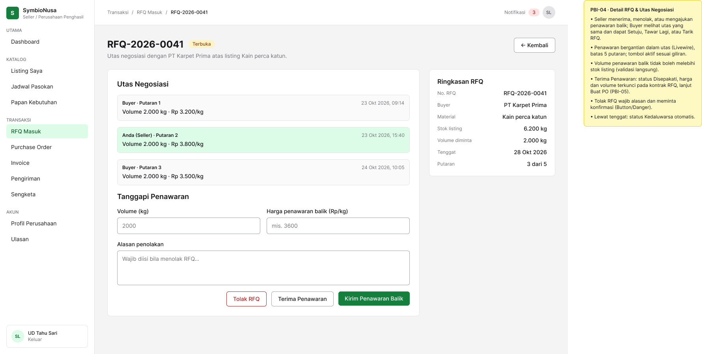

PBI-05 Daftar Purchase Order (Buyer)

Halaman ini digunakan untuk mengelola daftar Purchase Order (PO) yang dibuat dari kontrak RFQ yang telah disepakati. Terdapat kartu rekapitulasi status PO beserta tabel lengkap yang memuat informasi material, seller, volume, harga, dan tombol aksi seperti Lihat dan Batalkan.

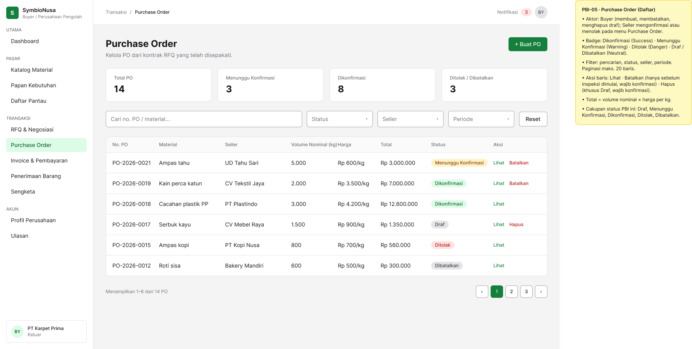

PBI-05 Form Buat Purchase Order (Buyer)

Halaman ini berisi formulir pengisian pembuatan PO baru berdasarkan kontrak RFQ berstatus disepakati. Pengguna dapat melihat data seller, material, volume, dan harga yang terisi otomatis dari kontrak, serta menggunakan tombol "Simpan Draf" atau "Kirim ke Seller"

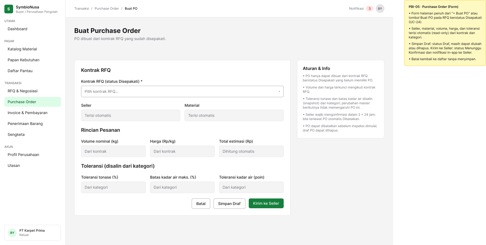

PBI-05 Detail PO dan Konfirmasi (Seller)

Halaman ini memperlihatkan rincian pesanan PO bagi Seller untuk meninjau pesanan dan mengambil tindakan. Halaman ini dilengkapi indikator stepper status order, rincian volume dan toleransi, serta kolom alasan penolakan beserta tombol konfirmasi atau penolakan PO.

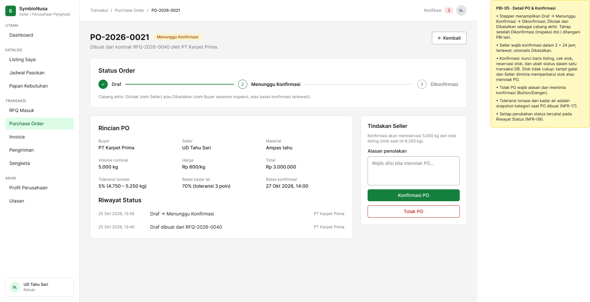

PBI-06 Daftar Invoice & Rekap Umur Tagihan (Seller)

Halaman ini digunakan untuk mengelola tagihan atas PO yang telah lolos inspeksi. Halaman memuat rekap umur tagihan, tombol untuk menerbitkan invoice, serta tabel daftar invoice lengkap dengan status dan opsi aksi seperti unduh PDF dan void.

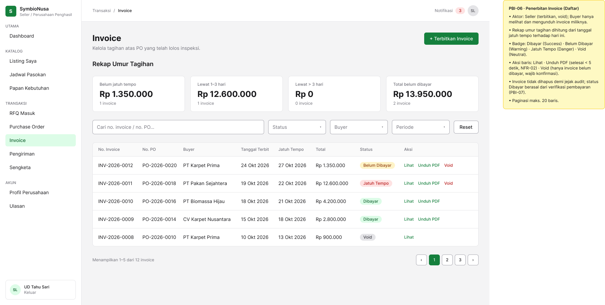

PBI-06 Form Terbitkan Invoice (Seller)

Halaman Terbitkan Invoice adalah formulir bagi Seller untuk menerbitkan tagihan atas PO yang lolos inspeksi. Setelah pengguna memilih PO, data seperti Buyer, Material, volume, harga, dan total tagihan akan terisi otomatis, sehingga pengguna hanya perlu menentukan tanggal jatuh tempo dan catatan opsional sebelum menekan tombol "Terbitkan Invoice" untuk mengirim tagihan serta notifikasi ke Buyer.

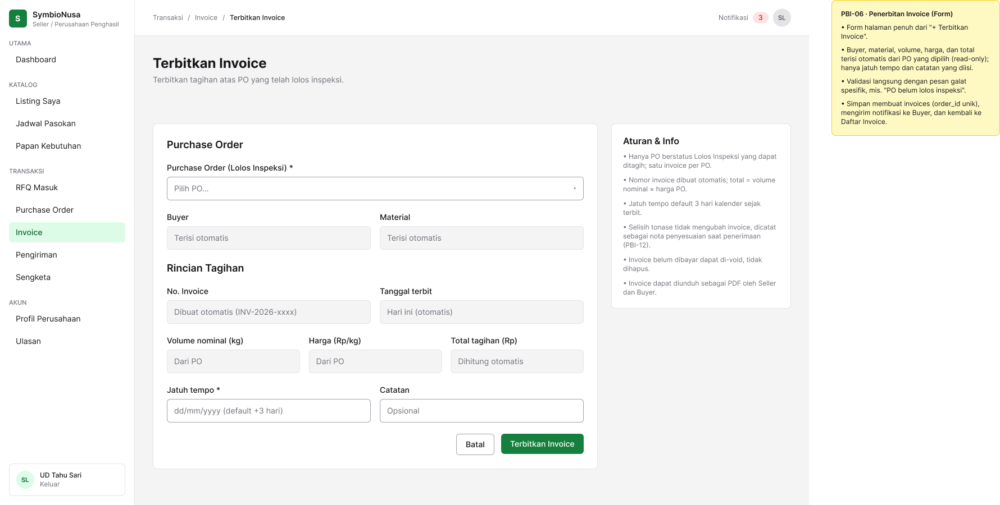

PBI-06 Dialog Konfirmasi Void Invoice

Antarmuka modal ini muncul sebagai dialog konfirmasi destruktif saat pengguna hendak melakukan void pada nomor invoice tertentu. Di dalam modal terdapat peringatan terkait kebijakan void serta kolom wajib diisi untuk memasukkan alasan void sebelum menekan tombol konfirmasi.

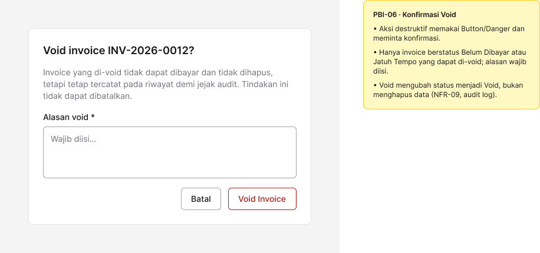

PBI-07 - Unggah Bukti Pembayaran (Buyer)

Antarmuka ini digunakan oleh pembeli (Buyer) untuk mengunggah bukti pembayaran setelah melakukan transfer sesuai dengan tagihan invoice. Pada halaman ini, pembeli dapat mengisi detail transfer, seperti tanggal transfer, nominal pembayaran, rekening asal, serta mengunggah bukti transfer. Selain itu, terdapat ringkasan invoice yang membantu pembeli memastikan kesesuaian jumlah tagihan sebelum mengirimkan bukti pembayaran untuk diverifikasi oleh penjual.

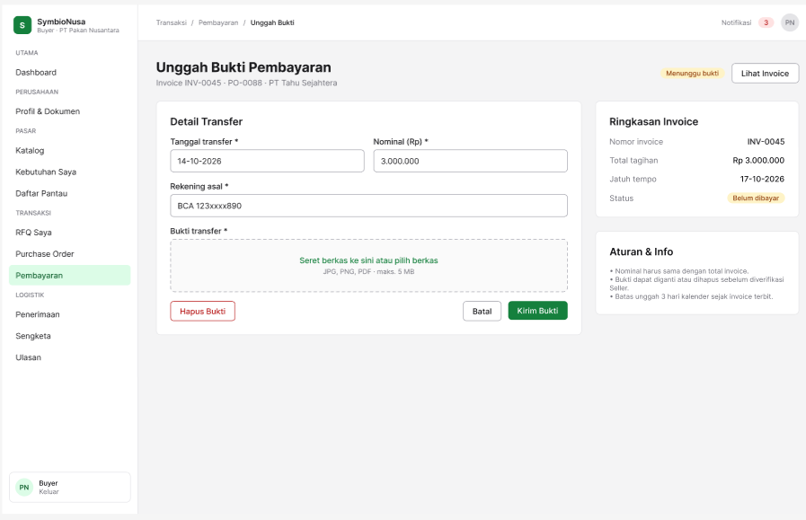

PBI-07 - Verifikasi Pembayaran (Seller)

Antarmuka ini digunakan oleh penjual (Seller) untuk memeriksa dan memverifikasi bukti pembayaran yang telah diunggah oleh pembeli. Pada halaman ini, penjual dapat melihat bukti transfer, memeriksa detail transaksi, serta mencocokkan nominal pembayaran dengan tagihan invoice. Penjual dapat memilih tombol verifikasi apabila pembayaran sesuai atau tombol tolak apabila bukti pembayaran tidak valid, disertai catatan alasan penolakan. Proses ini bertujuan untuk memastikan pembayaran telah diperiksa sebelum status pembayaran diperbarui dalam sistem.

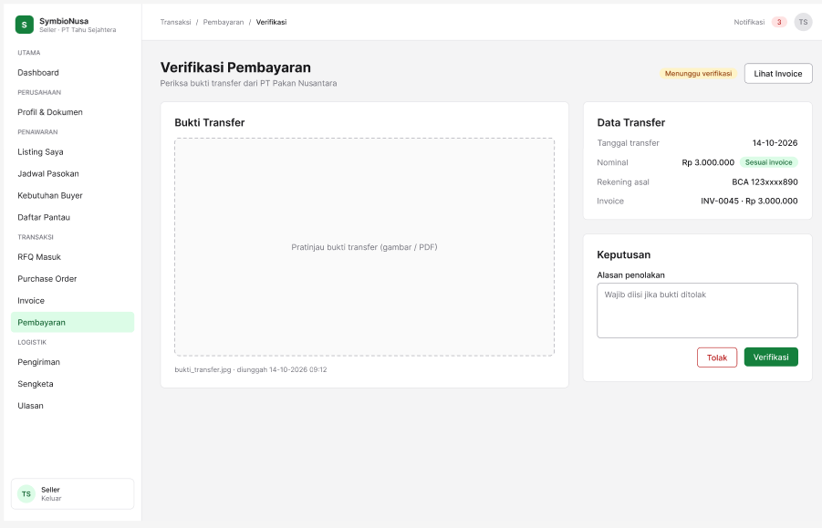

PBI - 08 Profil dan Perusahaan

Fitur Profil Perusahaan digunakan untuk melihat dan mengelola informasi perusahaan yang terdaftar di platform SymbioNusa. Pengguna dapat meninjau informasi perusahaan, mencari perusahaan berdasarkan nama atau kata kunci, serta memilih data perusahaan untuk melihat detail atau melakukan perubahan apabila memiliki hak akses.

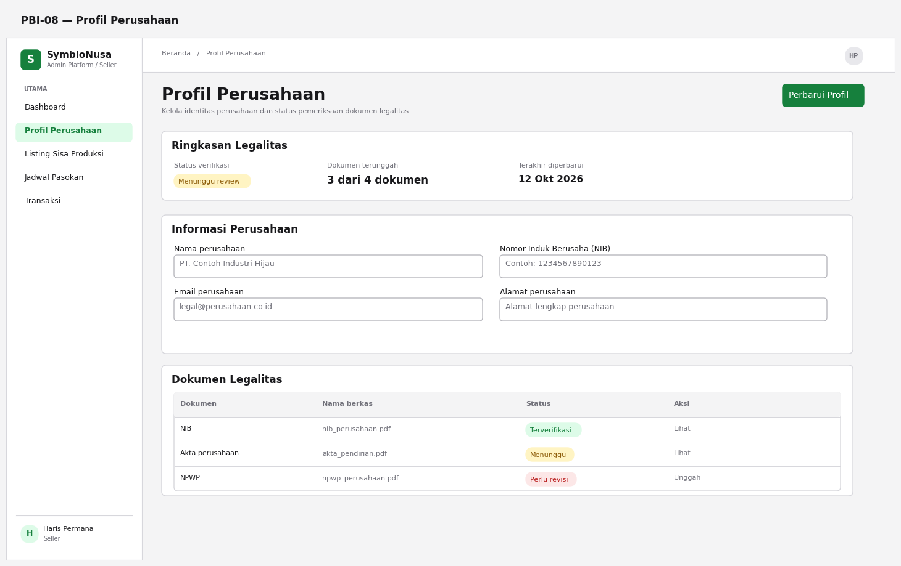

PBI - 08 Form Profil dan Legalitas

Fitur ini digunakan untuk memasukkan dan memperbarui informasi identitas serta legalitas perusahaan. Pengguna mengisi data yang diperlukan, seperti nama perusahaan, alamat, informasi kontak, dan detail dokumen legalitas sesuai kebutuhan sistem. Setelah data dilengkapi, pengguna dapat memeriksa kembali informasi yang dimasukkan sebelum menyimpan perubahan.

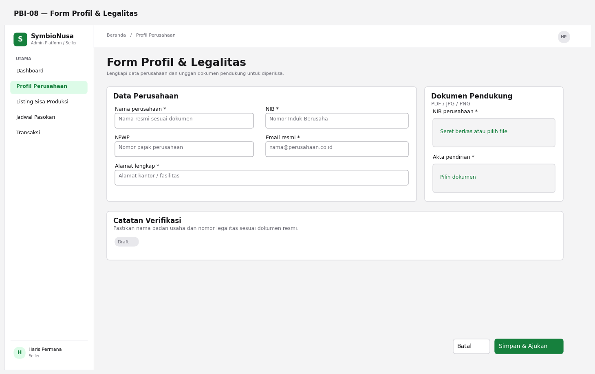

PBI - 09 Listing Sisa Produk

Fitur Listing Sisa Produksi digunakan untuk menampilkan dan mengelola informasi sisa produksi atau material yang berpotensi dimanfaatkan kembali oleh pihak lain. Pengguna dapat meninjau informasi material yang tersedia, seperti nama material, kategori, jumlah, satuan, dan status ketersediaannya apabila data tersebut disediakan. Informasi ini membantu pengguna mengidentifikasi material yang berpotensi digunakan kembali, sekaligus mendukung transparansi ketersediaan material dalam ekosistem SymbioNusa.

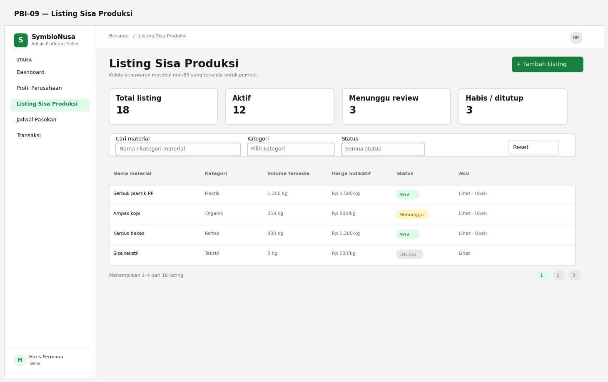

PBI - 09 Form Listing Material

Fitur Form Listing Material digunakan untuk mendaftarkan sisa produksi atau material agar informasinya dapat ditampilkan dalam daftar material SymbioNusa. Pengguna mengisi detail material yang relevan, seperti nama, kategori, deskripsi, jumlah, satuan, serta informasi ketersediaan. Sebelum menyimpan, pengguna dapat memeriksa kembali data yang telah diisi agar informasi material lebih jelas dan mudah dipahami oleh calon pihak yang membutuhkan. Data yang tersimpan selanjutnya dapat ditampilkan pada halaman daftar material sesuai aturan sistem.

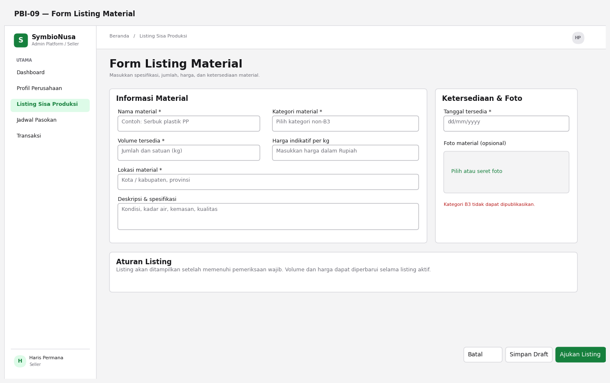

PBI - 10 Jadwal Pasokan Berkala

Fitur Jadwal Pasokan Berkala digunakan untuk melihat dan memantau rencana ketersediaan atau pengiriman material berdasarkan periode tertentu. Pengguna dapat meninjau jadwal yang telah dibuat, termasuk informasi material, tanggal pasokan, frekuensi, dan status jadwal apabila tersedia. Melalui halaman ini, pengguna dapat memahami kapan material direncanakan tersedia sehingga perencanaan kebutuhan dan koordinasi pasokan dapat dilakukan dengan lebih teratur.

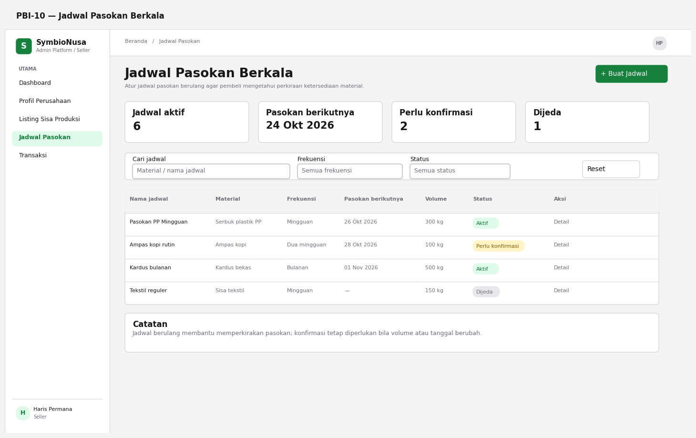

PBI -10 Form Jadwal Pasokan

Fitur Form Jadwal Pasokan digunakan untuk membuat atau memperbarui rencana pasokan material berdasarkan waktu dan periode yang ditentukan. Pengguna memilih material yang akan dipasok, kemudian mengisi informasi jadwal, seperti tanggal mulai, frekuensi pasokan, jumlah, atau keterangan tambahan sesuai kebutuhan sistem. Sebelum menyimpan, pengguna dapat meninjau kembali detail jadwal agar rencana pasokan tercatat dengan jelas. Informasi tersebut kemudian dapat digunakan untuk memantau dan mengoordinasikan pasokan secara berkala.

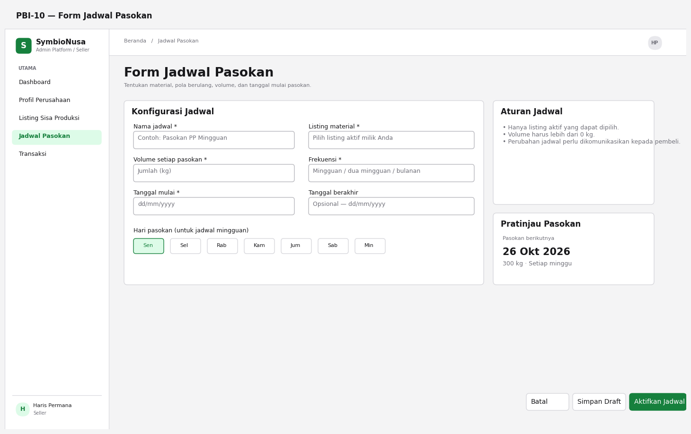

PB - 11 Pengiriman & Manifes Formulir

Halaman ini berfungsi untuk mengelola dan melengkapi formulir pembuatan manifes pengiriman barang, mulai dari pengisian data armada, pengunggahan dokumen surat jalan, hingga memantau status serta ringkasan riwayat pengiriman secara langsung.

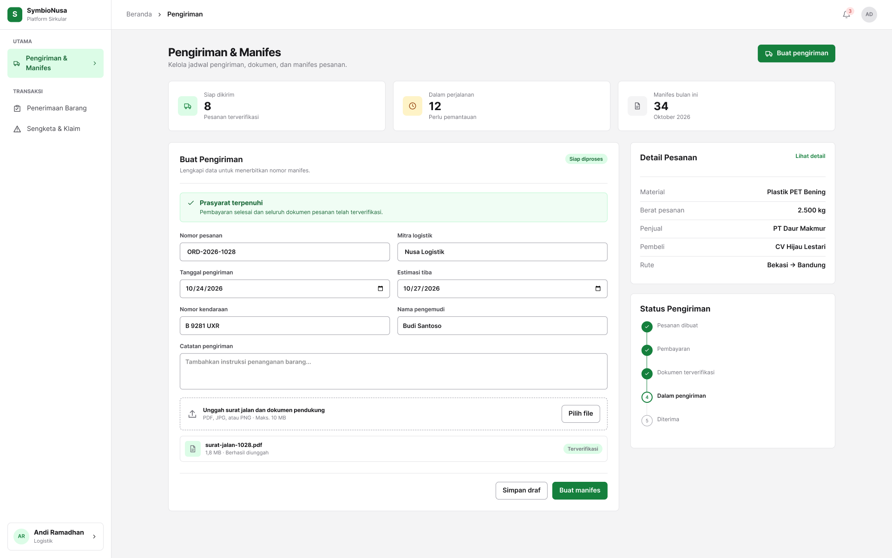

PB 12 Penerimaan Barang

Halaman ini digunakan untuk mencatat hasil penimbangan serta verifikasi kondisi fisik barang yang tiba di lokasi tujuan, lengkap dengan pencatatan selisih berat, evaluasi toleransi kerugian, alasan penolakan material, dan opsi pengunggahan foto bukti penerimaan.

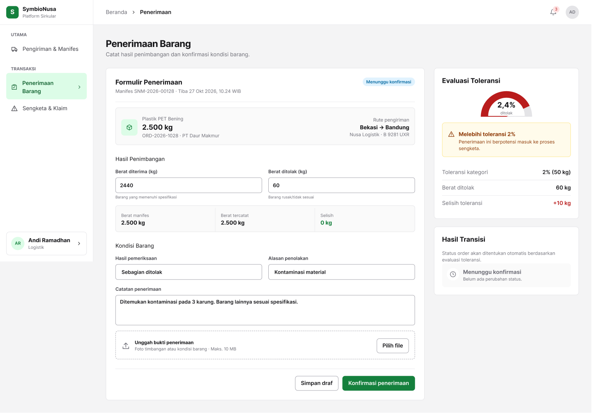

PBI 13 Sengketa & Klaim Formulir

Tampilkan daftar tiket sengketa, detail laporan dan bukti, tanggapan pihak lawan, serta panel putusan Admin.

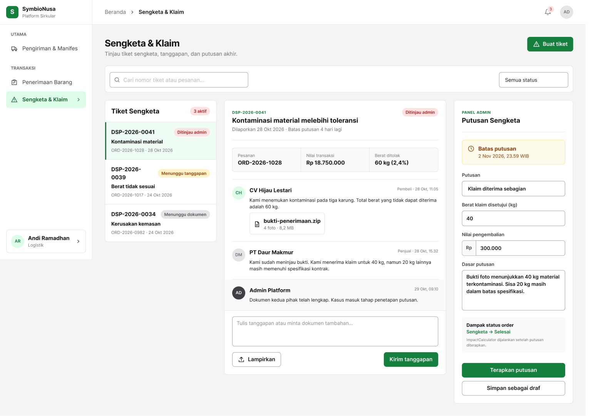

PBI-14 - Daftar Kebutuhan Saya (Buyer)

Antarmuka ini digunakan oleh pembeli (Buyer) untuk melihat dan mengelola daftar kebutuhan yang telah dibuat sendiri. Pada halaman ini, pembeli dapat memantau informasi kebutuhan, seperti nama komoditas, jumlah yang dibutuhkan, harga, tanggal, dan status permintaan. Pembeli juga dapat mencari dan memfilter daftar kebutuhan serta melihat, mengubah, atau menghapus kebutuhan sesuai dengan fitur yang tersedia. Halaman ini membantu pembeli memantau perkembangan permintaan barang yang telah diajukan kepada penjual.

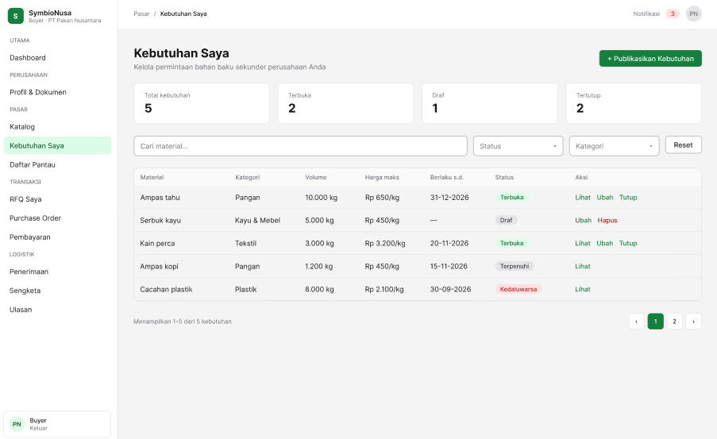

PBI-14 - Papan Kebutuhan Buyer (tampilan Seller)

Antarmuka ini digunakan oleh penjual (Seller) untuk melihat dan mengelola daftar kebutuhan yang diajukan oleh pembeli. Pada halaman ini, penjual dapat melihat informasi kebutuhan, seperti nama pembeli, komoditas yang dibutuhkan, jumlah permintaan, wilayah, serta status kebutuhan. Tersedia juga fitur pencarian dan filter untuk memudahkan penjual menemukan kebutuhan yang sesuai dengan produk yang ditawarkan. Melalui halaman ini, penjual dapat melihat detail kebutuhan dan mengajukan penawaran kepada pembeli sesuai dengan permintaan yang tersedia.

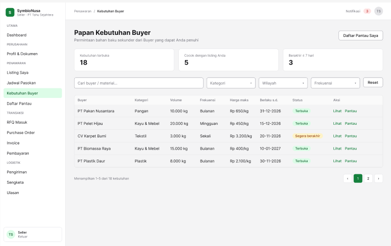

PBI-14 - Form Publikasikan Kebutuhan (Buyer)

Antarmuka ini digunakan oleh pembeli (Buyer) untuk mempublikasikan kebutuhan material agar dapat dilihat oleh penjual. Pada halaman ini, pembeli dapat mengisi kategori material, volume atau jumlah kebutuhan, frekuensi permintaan, harga maksimal, tanggal berlaku sampai, serta spesifikasi material seperti kadar air dan kebersihan. Pembeli juga dapat menambahkan catatan tambahan untuk menjelaskan kebutuhan secara lebih rinci. Setelah semua informasi diisi, pembeli dapat menyimpan kebutuhan sebagai draf atau langsung mempublikasikannya agar penjual dapat melihat dan memberikan penawaran sesuai dengan kebutuhan yang diajukan.

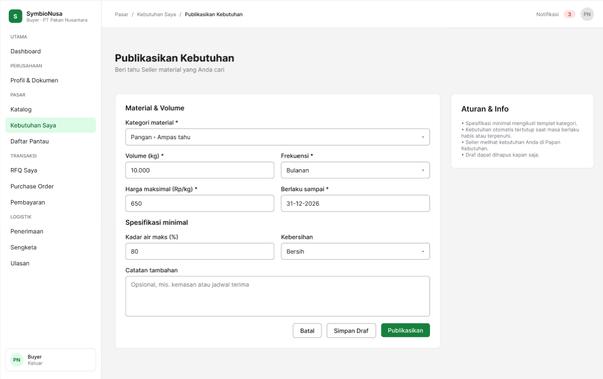

PBI-15 - Ulasan & Rating Mitra (Buyer)

Antarmuka ini digunakan oleh pembeli (Buyer) untuk memberikan ulasan dan penilaian terhadap transaksi atau material yang diterima dari penjual. Pada halaman ini, pembeli dapat memberikan rating berupa bintang untuk beberapa aspek, seperti mutu, ketepatan, dan komunikasi, serta menuliskan komentar mengenai pengalaman transaksi. Selain itu, tersedia informasi skor mitra dan riwayat ulasan yang telah diberikan. Fitur ini bertujuan untuk membantu pembeli menyampaikan pengalaman transaksi sekaligus menjadi bahan evaluasi bagi penjual dalam meningkatkan kualitas layanan.

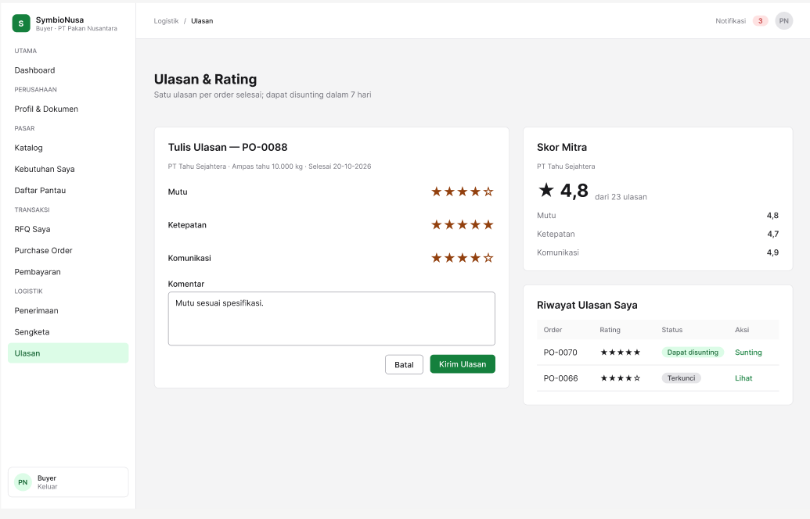

PBI-15 · Moderasi Ulasan (Admin)

Antarmuka ini digunakan oleh administrator untuk mengelola dan memoderasi ulasan yang diberikan oleh pengguna. Pada halaman ini, admin dapat melihat daftar ulasan, informasi pemberi dan penerima ulasan, rating, komentar, serta status moderasi. Admin dapat menyetujui ulasan yang sesuai atau menyembunyikan ulasan yang melanggar ketentuan platform. Fitur ini bertujuan untuk menjaga kualitas, relevansi, dan kepercayaan terhadap ulasan yang ditampilkan dalam aplikasi.

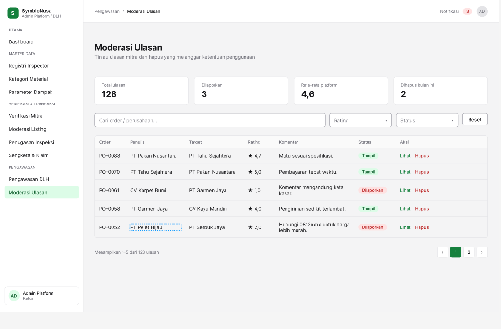

PBI-16 - Daftar Pantau & Peringatan Material

Antarmuka ini digunakan oleh pembeli (Buyer) untuk menambahkan pantauan terhadap kebutuhan material tertentu agar dapat memantau informasi dan perubahan penawaran yang sesuai dengan kriteria yang diinginkan. Pada halaman ini, pembeli dapat menentukan kategori material, wilayah, volume minimum dan maksimum, rentang harga, serta harga maksimum yang diinginkan. Pembeli juga dapat mengaktifkan atau menonaktifkan status pantauan sebelum menyimpannya. Fitur ini membantu pembeli memantau ketersediaan material yang sesuai dengan kebutuhannya secara lebih mudah.

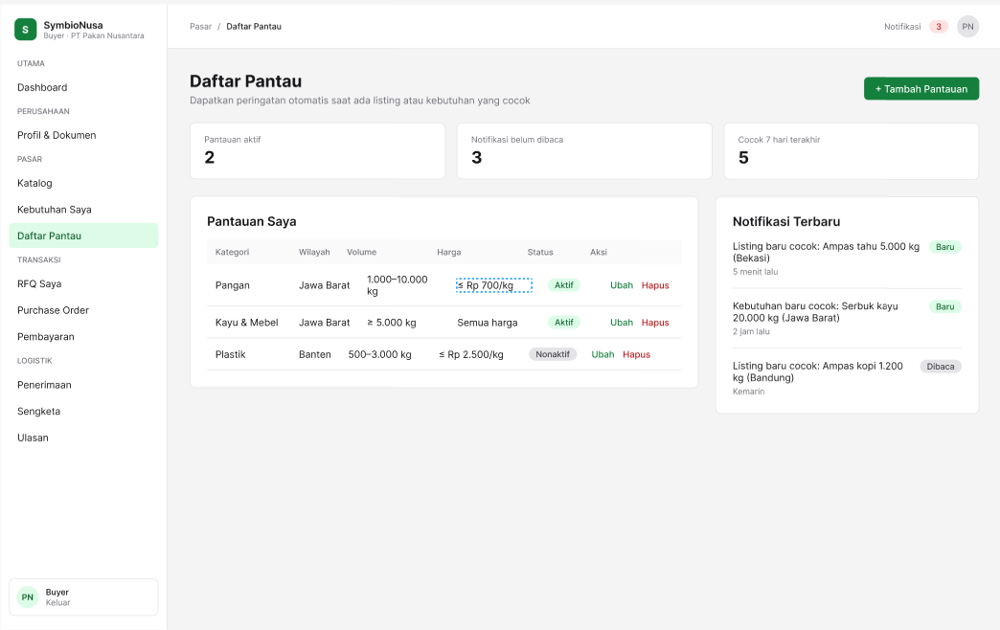

PBI-16 - Form Tambah Pantauan

Antarmuka ini digunakan oleh pembeli (Buyer) untuk membuat pantauan berdasarkan kriteria material yang dibutuhkan. Pada halaman ini, pembeli dapat menentukan kategori material, wilayah, volume minimum dan maksimum, serta rentang harga material yang diinginkan. Pembeli juga dapat mengaktifkan atau menonaktifkan fitur pantauan sesuai kebutuhan. Setelah kriteria diisi, pembeli dapat menekan tombol Simpan Pantauan agar sistem memberikan notifikasi ketika terdapat daftar atau kebutuhan baru yang sesuai dengan kriteria tersebut. Fitur ini membantu pembeli menemukan material yang sesuai tanpa harus mencari secara manual setiap saat.

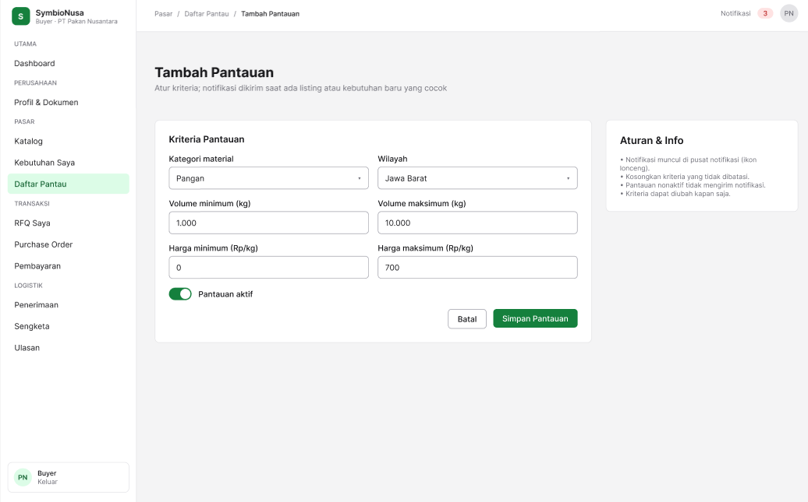

PBI 17 - Verifikasi Dokumen

Halaman ini dipakai Inspector untuk memeriksa dokumen perusahaan dan bukti listing. Di sisi kiri ada pratinjau dokumen dengan tab untuk berpindah antara dokumen legalitas, izin usaha, dan bukti listing. Di sisi kanan ada checklist verifikasi dan kolom catatan. Setelah selesai memeriksa, Inspector menekan tombol Setujui atau Tolak. Hanya Inspector yang ditugaskan yang dapat memutuskan, dan hasilnya menjadi syarat pengiriman.

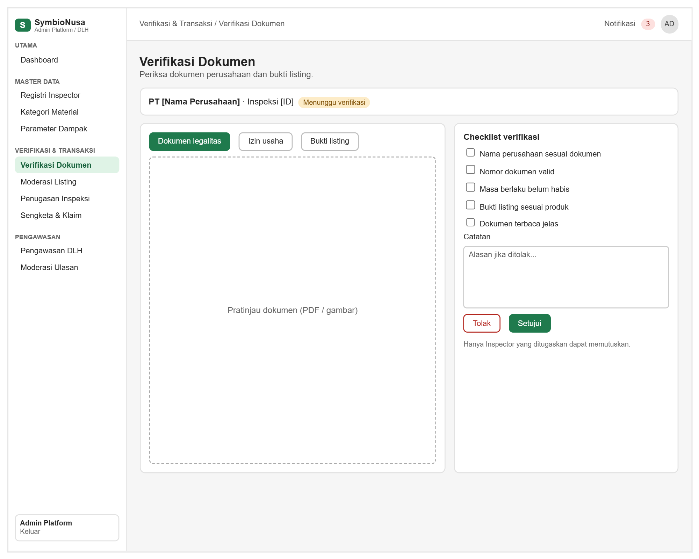

PBI 18 - Penugasan Inspeksi

Halaman ini membantu admin memilih Inspector yang sesuai untuk sebuah inspeksi. Bagian atas menampilkan data order dan rekomendasi mode verifikasi (Desk atau Lapangan) beserta alasannya. Di bawahnya ada tabel Inspector yang memuat keahlian, wilayah, beban kerja, dan tingkat kecocokan, sehingga admin bisa langsung memilih. Kalender beban menunjukkan kepadatan jadwal tiap Inspector dengan warna hijau, kuning, dan merah. Dengan begitu admin bisa menghindari jadwal yang bentrok sebelum menekan tombol Tugaskan Inspector.

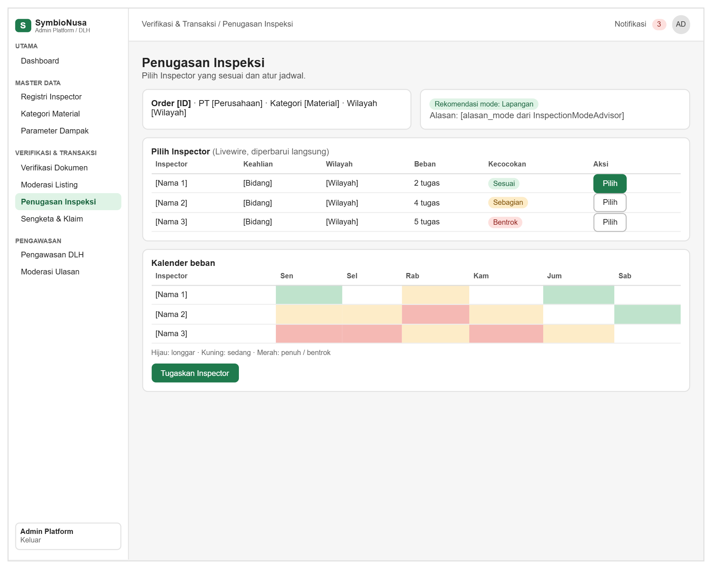

PBI 19 - Laporan Hasil Verifikasi Mutu

Halaman ini dipakai Inspector untuk mengisi laporan setelah inspeksi selesai. Tabel parameter memuat ambang batas, nilai hasil pemeriksaan, sumber bukti, dan lampiran untuk tiap parameter. Sistem menilai tiap parameter secara otomatis (Lolos atau Tidak lolos) berdasarkan ambang batasnya. Di bagian bawah ada kolom ringkasan hasil dan penilaian keseluruhan. Inspector bisa menyimpan draf dulu atau langsung menekan Finalisasi, yang akan mengubah status inspeksi ke tahap berikutnya.

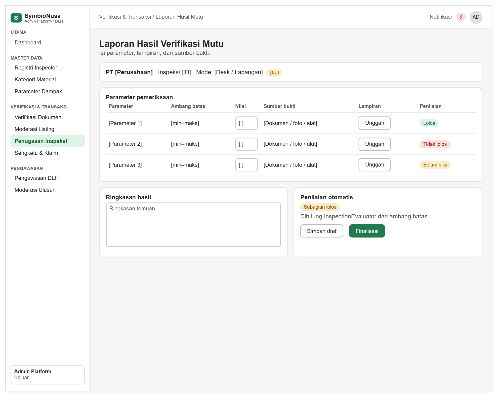

PBI 20 - Pengawasan DLH

Halaman ini dipakai untuk memantau kepatuhan perusahaan. Sisi kiri menampilkan tabel temuan per perusahaan lengkap dengan status tindak lanjut (Belum, Diproses, Selesai), serta kolom pencarian dan filter status. Sisi kanan berisi formulir untuk mencatat temuan baru. Tombol Ekspor Excel di pojok kanan atas dipakai untuk mengunduh data temuan sebagai file Excel.

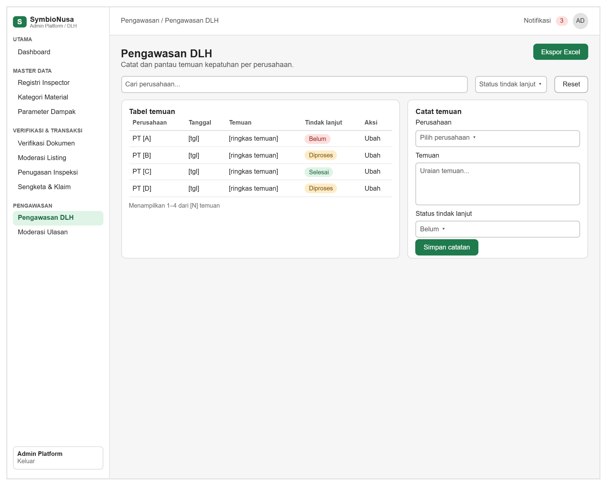

# Metode Pengembangan

Seluruh anggota adalah Fullstack Developer: setiap PBI dikerjakan penanggung jawabnya secara end-to-end, yaitu perancangan antarmuka, logika API/backend, dan kueri serta skema basis data. Setiap anggota juga memiliki spesialisasi modul untuk mengelompokkan PBI yang saling terkait dan memudahkan koordinasi

## Jadwal Pengembangan

Pengembangan platform SymbioNusa dilaksanakan menggunakan kerangka kerja Agile/Scrum yang terbagi ke dalam 2 Sprint utama. Durasi masing-masing Sprint disepakati selama 3 minggu untuk memastikan seluruh siklus pengkodean, integrasi, dan pengujian berjalan secara terukur.

Seluruh anggota tim bertindak sebagai Fullstack Developer. Pada Sprint 1, setiap anggota difokuskan untuk menyelesaikan fitur fondasi kolektif (autentikasi dan Main Dashboard) serta 2 PBI inti pada domain modul masing-masing. Selanjutnya pada Sprint 2, tim menyelesaikan PBI tingkat lanjut (logistik, penerimaan, sengketa, Impact Engine, ulasan, dan pengawasan DLH) diikuti dengan pengujian menyeluruh (System Integration Testing & UAT) serta deployment ke lingkungan staging.

- Timeline dan Siklus Pelaksanaan Sprint

| Minggu ke- | Siklus / Fase | Aktivitas Utama | Deliverables / Output |
|---|---|---|---|
| Minggu 1 | Sprint 1: Planning & Core Setup | Setup kerangka Laravel 11, Livewire 3, Tailwind CSS, database migration, dan fitur fondasi (FND-01 s.d. FND-04). | Repository aktif, skema basis data awal, modul autentikasi & layout dasbor. |
| Minggu 2 | Sprint 1: Core PBI Development | Pengkodean PBI Tahap 1 (Master Data, Legalitas Perusahaan, Listing Katalog, RFQ/PO, Pembayaran, dan Penugasan Inspeksi) | Feature branch PBI tahap 1 selesai & siap code review. |
| Minggu 3 | Sprint 1: Integration & Review | Merge ke branch utama, integrasi alur transaksi awal, Sprint Review 1, dan Laporan Progress Sprint 1. | Demonstrasi Sprint 1 (Sistem Onboarding, Katalog, Negosiasi RFQ & PO terintegrasi) |
| Minggu 4 | Sprint 2: Advanced PBI Development | Pengkodean PBI Tahap 2 (Manifes Pengiriman, Penerimaan Barang, Sengketa, ImpactCalculator, Ulasan, dan Modul DLH). | Feature branch PBI tahap 2 selesai dikembangkan |
| Minggu 5 | Sprint 2: End-to-End System Testing | Integrasi State Machine lengkap, pengujian batas toleransi, eksekusi Unit Test/Feature Test (PHPUnit/Pest), dan perbaikan bug. | Seluruh 20 PBI terintegrasi tanpa critical bug, cakupan uji >=60% |
| Minggu 6 | Sprint 2: Deployment & Final Review | Deployment ke server staging, dokumentasi API (Scribe), pembuatan video demonstrasi aplikasi, dan Sprint Review 2. | Aplikasi web SymbioNusa live di staging, video presentasi 15 menit, dan dokumen final. |

- Distribusi PBI dan Bobot Kerja per Sprint

Distribusi pengerjaan 20 Product Backlog Item (PBI) ke dalam 2 Sprint untuk setiap anggota tim dirinci sebagai berikut:

| Anggota Tim & Peran | Focus Modul | PBI Sprint 1 (Minggu 1–3) | PBI Sprint 2 (Minggu 4–6) | Total SP |
|---|---|---|---|---|
| Mayhesa Rachmadiharja (PM & Fullstack) | Master Data & Impact Module | PBI-01 Registri Inspector (3 SP) PBI-02 Master Kategori & Templat (5 SP) | PBI-03 Parameter Dampak & Engine ImpactCalculator (5 SP) | 13 SP (+5 SP PM) |
| Achmad Dhafi Fadilah (Fullstack) | Transaction Module | PBI-04 RFQ & Negosiasi Penawaran (8 SP) PBI-05 Purchase Order (PO) (5 SP) | PBI-06 Penerbitan Invoice & Rekap Tagihan (5 SP) | 18 SP |
| Haris Permana (Fullstack) | Seller Catalog Module | PBI-08 Profil & Legalitas Perusahaan (5 SP) PBI-09 Listing Sisa Produksi (8 SP) | PBI-10 Jadwal Pasokan Berkala (5 SP) | 18 SP |
| Inaya Keisha S. (Fullstack) | Logistics & Fulfillment | PBI-11 Pengiriman & Manifes Angkut (5 SP) PBI-12 Penerimaan Barang & Realisasi (8 SP) | PBI-13 Sengketa & Klaim (5 SP) | 18 SP |
| M Zacky Aghaatsa (Fullstack) | Buyer Demand & Engagement | PBI-07 Verifikasi Pembayaran (3 SP) PBI-14 Kebutuhan Bahan Baku (5 SP) | PBI-15 Ulasan & Rating Mitra (3 SP) PBI-16 Daftar Pantau & Peringatan (5 SP) | 16 SP |
| Rosita Jian Syahiirah (Fullstack) | Inspection & Compliance | PBI-17 Verifikasi Dokumen Non-B3 (5 SP) PBI-18 Penugasan Inspeksi (5 SP) | PBI-19 Laporan Hasil Mutu (5 SP) PBI-20 Pengawasan & Catatan DLH (3 SP) | 18 SP |
| TOTAL BEBAN PBI | 20 PBI Fungsional | 12 PBI (63 SP) | 8 PBI (38 SP) | 101 SP |

- Aturan Kolaborasi dan Standar Pengkodean Tim

Untuk menjaga kualitas repositori dan profesionalisme pengembangan software, tim menetapkan standar kerja teknis berikut:

- Aturan Percabangan (Git Branching Strategy):

- Setiap mahasiswa menggunakan 1 branch khusus sesuai nama masing-masing yang menampung seluruh pengerjaan PBI milik pengembang tersebut.

- Branch main / staging dilindungi (protected); penggabungan kode (merge) hanya dapat dilakukan melalui Pull Request (PR) setelah lolos peninjauan (code review) oleh anggota tim lain.

- Konvensi Commit (Conventional Commits):

Seluruh riwayat commit wajib mengikuti format terstruktur agar tercatat secara profesional dan mudah ditelusuri per PBI (contoh: feat(PBI-04): add counter-offer negotiation logic atau fix(PBI-12): adjust weight tolerance calculation).

## Tim Pengembang

Seluruh anggota adalah Fullstack Developer: setiap PBI dikerjakan penanggung jawabnya secara end-to-end, yaitu perancangan antarmuka, logika API/backend, dan kueri serta skema basis data. Setiap anggota juga memiliki spesialisasi modul untuk mengelompokkan PBI yang saling terkait dan memudahkan koordinasi.

## Ringkasan Tim

| NIM | Nama Lengkap | Peran Utama | Deskripsi Tanggung Jawab End-to-End (PBI yang Dipegang) |
|---|---|---|---|
| 102022400163 | Mayhesa Rachmadiharja | Project Manager & Fullstack Developer (Spesialisasi: Master Data & Impact Module) | Mengoordinasikan tim, sprint, dan integrasi; mengerjakan PBI-01 Registri Inspector, PBI-02 Master Kategori & Templat Spesifikasi, dan PBI-03 Parameter Dampak & Faktor Emisi; menyiapkan kerangka proyek Laravel (struktur modul, Breeze, CI/CD) dan memimpin mesin perhitungan dampak (ImpactCalculator). |
| 102022400362 | Achmad Dhafi Fadilah | Fullstack Developer (Spesialisasi: Transaction Module) | Mengerjakan PBI-04 RFQ & Negosiasi, PBI-05 Purchase Order, dan PBI-06 Penerbitan Invoice; memegang OrderStateMachine. |
| 102022400355 | Haris Permana | Fullstack Developer (Spesialisasi: Seller Catalog Module) | Mengerjakan PBI-08 Profil & Verifikasi Legalitas Perusahaan, PBI-09 Listing Sisa Produksi, dan PBI-10 Jadwal Pasokan Berkala. |
| 102022400105 | Inaya Keisha Sukmawardy | Fullstack Developer (Spesialisasi: Logistics & Fulfillment Module) | Mengerjakan PBI-11 Pengiriman & Manifes Angkut, PBI-12 Penerimaan Barang & Realisasi Tonase, dan PBI-13 Sengketa & Klaim; memimpin migrasi basis data dan memegang ToleranceEvaluator. |
| 102022400034 | M Zacky Aghaatsa | Fullstack Developer (Spesialisasi: Buyer Demand & Engagement Module) | Mengerjakan PBI-07 Verifikasi Pembayaran, PBI-14 Kebutuhan Bahan Baku Sekunder, PBI-15 Ulasan & Rating Mitra, dan PBI-16 Daftar Pantau & Peringatan; memegang NotificationService. |
| 102022430050 | Rosita Jian Syahiirah | Fullstack Developer (Spesialisasi: Inspection & Compliance Module) | Mengerjakan PBI-17 Verifikasi Dokumen Legalitas Non-B3, PBI-18 Penugasan Inspeksi, PBI-19 Laporan Hasil Verifikasi Mutu, dan PBI-20 Pengawasan & Tindak Lanjut DLH; memegang InspectionModeAdvisor. |

## Tanggung Jawab Kolektif (Seluruh Anggota)

- Fondasi autentikasi dengan Laravel Breeze: login, logout, reset password (FND-01 s.d. FND-03).

- Kerangka Main Dashboard (FND-04); setiap anggota menyumbang satu kartu ringkasan dari modulnya.

- Menghadiri Sprint Planning, Daily Scrum, Review, dan Retrospective.

- Melakukan code review silang sebelum penggabungan kode.

- Menyusun bagian proposal dan dokumentasi sesuai modul masing-masing.

- Rincian Tanggung Jawab End-to-End per Anggota

Setiap PBI dikerjakan oleh penanggung jawabnya pada tiga lapisan Laravel: View (Blade/Livewire), Controller, Form Request, dan Service (logika), serta Model dan migrasi (basis data).

### Mayhesa Rachmadiharja (102022400163): Project Manager & Fullstack Developer, Master Data & Impact Module

| PBI | View (Blade/Livewire) | Controller, Request, dan Service | Model dan Migrasi |
|---|---|---|---|
| PBI-01 Registri Inspector | Tabel registri dengan filter keahlian, wilayah, status; formulir pendaftaran dan unggah sertifikat | InspectorProfileController (resource), StoreInspectorRequest; command terjadwal inspectors:deactivate-expired | InspectorProfile; migrasi inspector_profiles (user_id unik, indeks status dan wilayah, soft deletes) |
| PBI-02 Master Kategori | Pohon kategori, pembuat templat spesifikasi (Livewire), sakelar larangan B3 | CategoryController (resource), CategoryRequest (validasi skema templat), CategoryService::canArchive() | Category; migrasi categories (relasi diri sendiri parent_id, kolom spec_schema bertipe JSON dengan array cast). |
| PBI-03 Parameter Dampak | Daftar versi, formulir faktor, simulasi pratinjau dampak (Livewire) | ImpactFactorController, ImpactFactorService::activate() (menonaktifkan faktor aktif sebelumnya dan mengaktifkan faktor baru dalam transaksi dengan penguncian data kategori untuk mencegah aktivasi bersamaan), ImpactSimulationController. | ImpactFactor; migrasi impact_factors dengan indeks pada kategori, versi, dan status aktif. Keaktifan satu versi per kategori dijaga melalui service dan transaksi basis data. |

### Achmad Dhafi Fadilah (102022400362): Fullstack Developer, Transaction Module

| PBI | View (Blade/Livewire) | Controller, Request, dan Service | Model dan Migrasi |
|---|---|---|---|
| PBI-04 RFQ & Negosiasi | Formulir RFQ, utas penawaran (Livewire), formulir penawaran balik dengan validasi stok langsung | RfqController, RfqOfferController, RfqService (batas putaran dan validasi volume), command terjadwal rfq:expire | RfqContract, RfqOffer; migrasi rfq_contracts, rfq_offers |
| PBI-05 Purchase Order | Daftar dan detail PO, tombol konfirmasi dan tolak, stepper status | PurchaseOrderController, PurchaseOrderPolicy, OrderStateMachine (sampai Dikonfirmasi), penyalinan toleransi dari kategori, reservasi stok dalam DB::transaction dengan lockForUpdate() | PurchaseOrder, OrderStatusHistory; enum OrderStatus; migrasi purchase_orders, order_status_history |
| PBI-06 Penerbitan Invoice | Formulir invoice, rekap umur tagihan, unduh PDF | InvoiceController, InvoiceNumberGenerator, templat PDF (dompdf), aksi void | Invoice; migrasi invoices (order_id unik) |

### Haris Permana (102022400355): Fullstack Developer, Seller Catalog Module

| PBI | View (Blade/Livewire) | Controller, Request, dan Service | Model dan Migrasi |
|---|---|---|---|
| PBI-08 Profil & Legalitas | Formulir profil dan persetujuan syarat dan ketentuan, unggah dokumen, antrean verifikasi Admin | CompanyController, CompanyDocumentController, middleware EnsureCompanyVerified, pemilih peran aktif untuk perusahaan bertipe keduanya | Company, CompanyDocument; migrasi companies, company_documents |
| PBI-09 Listing | Formulir listing dengan bidang spesifikasi dinamis (Livewire), katalog dengan filter dan paginasi | ListingController, ListingRequest (validasi sesuai templat, tolak kategori B3), query scope pencarian dan penyaringan | Listing; migrasi listings (indeks kategori, status, harga; status arsip) |
| PBI-10 Jadwal Pasokan | Formulir jadwal, kalender, proyeksi volume | SupplyScheduleController, SupplyScheduleService (validasi kapasitas dan aturan periode yang sudah dipesan) | SupplySchedule; migrasi supply_schedules |

### Inaya Keisha Sukmawardy (102022400105): Fullstack Developer, Logistics & Fulfillment Module.

| PBI | View (Blade/Livewire) | Controller, Request, dan Service | Model dan Migrasi |
|---|---|---|---|
| PBI-11 Pengiriman & Manifes | Formulir pengiriman, unggah dokumen, status pengiriman | ShipmentController, guard pada OrderStateMachine (sudah dibayar dan dokumen terverifikasi), pembuat nomor manifes | ShipmentManifest, ShipmentDocument; migrasi shipments_manifests, shipment_documents |
| PBI-12 Penerimaan Barang | Formulir penerimaan dengan berat diterima dan ditolak | GoodsReceiptController, GoodsReceiptRequest, ToleranceEvaluator; transisi Selesai atau Sengketa; event OrderCompleted memicu listener ImpactCalculator | GoodsReceipt; migrasi goods_receipts (shipment_id unik) |
| PBI-13 Sengketa & Klaim | Formulir tiket, utas tanggapan, panel putusan Admin | DisputeController, DisputeService (batas waktu pelaporan dan penerapan putusan pada status order) | Dispute; migrasi disputes |

### Zacky Aghaatsa (102022400034):Fullstack Developer, Buyer Demand, Payment & Engagement Module

| PBI | View (Blade/Livewire) | Controller, Request, dan Service | Model dan Migrasi |
|---|---|---|---|
| PBI-07 Verifikasi Pembayaran | Formulir unggah bukti (Buyer), antrean verifikasi (Seller) | PaymentController, StorePaymentRequest (nominal harus sama dengan invoice), transisi ke Dibayar, peringatan keterlambatan bukti | Payment; migrasi payments |
| PBI-14 Kebutuhan Bahan Baku | Formulir kebutuhan, papan kebutuhan dengan filter | DemandRequestController, DemandRequestRequest (validasi templat), command terjadwal demand:close-expired | DemandRequest; migrasi demand_requests |
| PBI-15 Ulasan & Rating | Formulir ulasan, tampilan skor rata-rata pada profil dan katalog | ReviewController, ReviewPolicy (jendela sunting 7 hari, hanya setelah Selesai), agregasi skor | Review; migrasi reviews (unik order dan penulis) |
| PBI-16 Daftar Pantau | Formulir kriteria pantau, daftar pantauan, pusat notifikasi (Livewire) | WatchlistController, listener MatchWatchlists saat listing atau kebutuhan dipublikasikan, notifikasi NewMatchNotification (kanal database) | Watchlist; migrasi watchlists; tabel notifications bawaan Laravel |

### Rosita Jian Syahiirah (102022430050): Fullstack Developer, Inspection & Compliance Module

| PBI | View (Blade/Livewire) | Controller, Request, dan Service | Model dan Migrasi |
|---|---|---|---|
| PBI-17 Verifikasi Dokumen | Pratinjau dokumen perusahaan dan bukti listing dengan checklist setuju atau tolak | DocumentVerificationController, DocumentVerificationPolicy (hanya Inspector yang ditugaskan); hasil menjadi syarat pengiriman | DocumentVerification; migrasi document_verifications |
| PBI-18 Penugasan Inspeksi | Pemilih Inspector yang sesuai (Livewire), rekomendasi mode Desk atau Lapangan, kalender beban | InspectionController, InspectionModeAdvisor, InspectorMatchingService (keahlian dan, untuk mode Lapangan, wilayah dari PBI-01), pengecekan bentrok jadwal | Inspection; migrasi inspections (mode_verifikasi, alasan_mode) |
| PBI-19 Laporan Hasil Verifikasi Mutu | Formulir parameter dengan lampiran dan sumber bukti, ringkasan hasil | InspectionResultController, InspectionEvaluator (penilaian ambang otomatis), finalisasi memicu transisi status | InspectionResult; migrasi inspection_results |
| PBI-20 Pengawasan DLH | Tabel temuan per perusahaan, formulir, tombol ekspor | ComplianceNoteController, ComplianceNoteExport (Laravel Excel), status tindak lanjut | ComplianceNote; migrasi compliance_notes |
